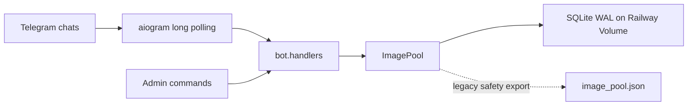
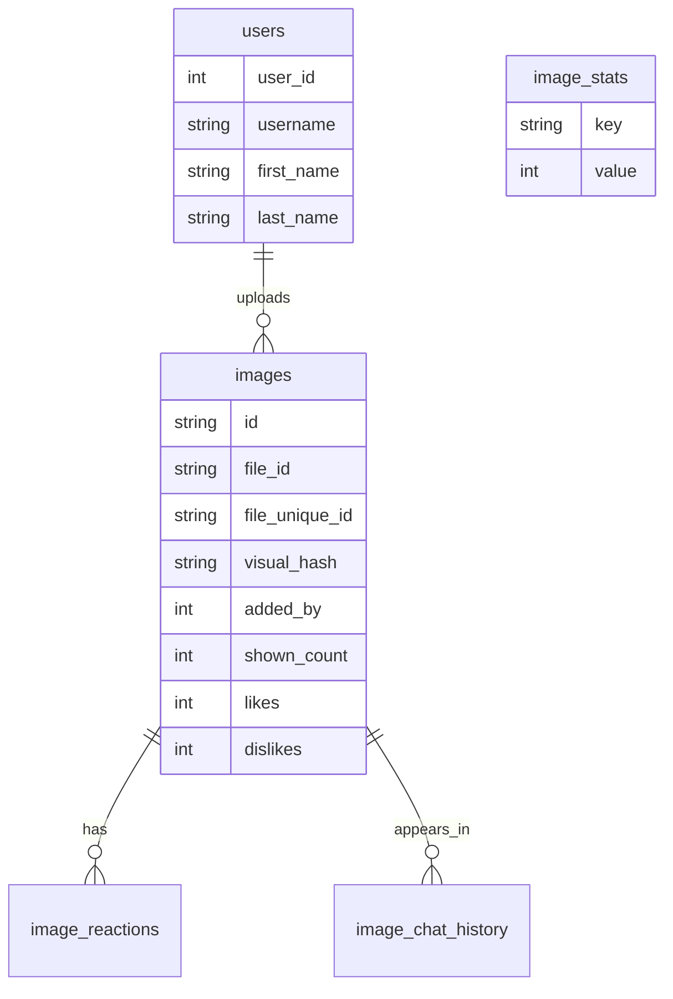

# kartinkomet-bot

**A Telegram bot for a shared image vault: random drops, private uploads, reactions, duels, tournaments, leaderboards, profiles, and admin maintenance**


`kartinkomet` runs in Telegram groups and private chats. In groups it sends random images, starts image duels and tournaments, and shows stats. In private chat it accepts new images into the shared pool.

Core rule: the bot **does not store image files**. It stores Telegram `file_id` and `file_unique_id`; the real media files stay on Telegram's side. The server stores only identifiers, reactions, random history, users, and statistics.

Detailed project map: [docs/ARCHITECTURE.md](docs/ARCHITECTURE.md). It documents files, data flow, storage, random logic, UI, maintenance scenarios, and invariants that should not be broken.

## Features

| Area | Behavior |
| --- | --- |
| 🎲 Random | Sends a random image with per-chat and global anti-repeat memory |
| 📥 Uploads | Accepts photos, packs, albums, and forwarded images in private chat |
| 🧬 Anti-duplicates | Skips exact duplicates and visually similar images with perceptual hashing |
| 🤙🏻 / 🖕🏻 | One reaction per user; users can switch their vote |
| ⚖️ Jury rule | `2 🖕🏻` remove an image from the pool |
| ⚔️ Duel | Two images, 60 second vote, loser is removed |
| 🏟 Tournament | Four images, 90 second vote, winner is highlighted, nobody is removed |
| 📊 Stats | Pool, random drops, reactions, duels, tournaments, and active arenas |
| 🏆 Top | Uploader leaderboard with Telegram names and titles |
| 👤 Profile | Personal contribution, reactions on uploaded images, achievements |
| 🧰 Admin panel | Health, backup, stat reset, and dedupe controls for admins, hidden from the public menu |
| 🧯 Protection | Upload rate limits, quiet duplicate skips, and throttled admin alerts |

## Architecture



Production runtime: **Railway + long polling + SQLite on a Volume**. No webhook domain or external database is required.

## Commands

| Command | Purpose |
| --- | --- |
| `/start` | Start message and control panel |
| `/menu` | Open the control panel |
| `/pic` | Send a random image |
| `/duel` | Start a two-image duel |
| `/tournament` | Start a four-image tournament |
| `/upload_pidor` | Start image upload mode in private chat |
| `/stats` | Show pool and arena stats |
| `/count` | Quick pool counter |
| `/me` | Personal player card |
| `/top` | Image uploader leaderboard |
| `/help` | Command map |

Private operations commands are not added to Telegram's public command menu. They are documented below in [Maintenance](#maintenance) and are guarded by `ADMIN_USER_IDS`.

## UX Model

### Main Panel

```text
🎲 Рандом      ⚔️ Арены
📦 Склад       📥 Загрузка
```

In groups, the upload button explains that uploads happen in private chat. This avoids Telegram Privacy Mode issues and makes albums, packs, and forwarded images much more reliable.

Buttons are built with semantic styles in `bot/keyboards.py`: `primary` for core actions, `success` for confirmations and constructive actions, and `danger` for cancellation, resets, and negative votes. Telegram clients that support colored inline buttons can render them more clearly; older clients simply fall back to normal buttons without breaking the UX.

### Upload Flow

1. Open private chat with the bot
2. Send `/upload_pidor` or press `📥 Начать загрузку`
3. Send photos, packs, albums, or forwarded images
4. Finish with `✅ Закончить` or `/done`
5. Cancel with `❌ Отмена` or `/cancel`

The bot stores only `file_id`, `file_unique_id`, and a service `visual_hash`. Exact duplicates by `file_unique_id` or `file_id` are skipped immediately; visually similar images are caught by perceptual hash checks. Repeated duplicates during batch uploads are skipped quietly, so the chat does not drown in status messages.

Limits:

- `1000` new images per hour per user;
- `120` incoming upload messages per minute while upload mode is active;
- invalid files go into the batch error counter.

### Random Picker

The picker does more than select a random row:

- avoids recent images in the current chat;
- avoids globally recent images;
- favors less shown images;
- gives a small bonus to new and rarely shown images;
- lowers the weight of images with many 🖕🏻;
- samples from a candidate window to keep the pool from looping on the same content.

### Duels And Tournaments

Duel:

- picks two images;
- sends them as an album;
- gives users 60 seconds to vote;
- removes the losing image;
- keeps both images on a tie.

Tournament:

- picks four images;
- gives users 90 seconds to vote;
- announces the champion;
- never removes images.

Stability rules:

- one active duel and one active tournament per chat;
- duel and tournament can run at the same time because they are separate arenas;
- stale sessions are cleared;
- repeated taps on the same button do not inflate votes.

## Storage

Main database:

```text
/data/kartinkomet.sqlite
```

Legacy JSON safety export:

```text
/data/image_pool.json
```

In production, the source of truth is the SQLite file `kartinkomet.sqlite` on the Railway Volume. JSON exists as a legacy fallback and compatibility layer for older utilities; it should not be treated as the primary live database during migration or backup. For a live backup, use `/backup`, because it creates a consistent SQLite copy through the backup API.

SQLite settings:

- `busy_timeout=30000`;
- `foreign_keys=ON`;
- `journal_mode=WAL`;
- `synchronous=NORMAL`.

Database shape:



## Railway

Required variables:

```env
BOT_TOKEN=123456:telegram-token
RAILWAY_VOLUME_MOUNT_PATH=/data
ADMIN_USER_IDS=177117495
```

Optional variables:

```env
DATABASE_PATH=/data/kartinkomet.sqlite
IMAGE_POOL_PATH=/data/image_pool.json
TARGET_CHANNEL_ID=
```

`Procfile`:

```procfile
worker: python -m bot
```

Railway must have a Volume mounted at `/data`. Without a Volume, the database lives inside the container and disappears when the environment is recreated.

## Local Development

```bash
python3.12 -m venv .venv
source .venv/bin/activate
python -m pip install --upgrade pip
pip install -r requirements.txt
cp .env.example .env
python -m bot
```

`.env`:

```env
BOT_TOKEN=123456:telegram-token
DATABASE_PATH=data/kartinkomet.sqlite
IMAGE_POOL_PATH=data/image_pool.json
ADMIN_USER_IDS=177117495
```

## Verification

```bash
.venv/bin/python -m compileall bot scripts tests
.venv/bin/python -m unittest
```

The test suite checks:

- public command list;
- removed features are absent from menus and copy;
- SQLite schema;
- reaction switching;
- random anti-repeat behavior;
- duel loser deletion;
- tournament result logic;
- keyboards;
- perceptual hash dedupe helpers;
- admin panel and health copy.

## Operations Notes

Production facts worth remembering:

- **one Railway replica** is required because Telegram long polling does not support multiple active `getUpdates` consumers;
- **Volume mounted at `/data`** is mandatory: SQLite, WAL files, and the legacy JSON safety export live there;
- **SQLite WAL** is the primary backend, keeping reads fast and data persistent across deploys;
- **Telegram `file_id`** remains the media source of truth, so image files do not consume server disk;
- **visual anti-duplicate checks** store perceptual hashes and compare them through a fast integer cache;
- **admin commands are hidden** from Telegram's public command menu and guarded by `ADMIN_USER_IDS`.

## Maintenance

### Admin Panel

```text
/admin
```

Shows the private admin cockpit:

- storage backend and paths;
- image and user counters;
- visual hash coverage;
- upload and auto-delete limits;
- buttons for backup, health, stat reset, and dedupe.

The command works only for users listed in `ADMIN_USER_IDS`.

### Health

```text
/health
```

Reports the current storage state, content counters, and activity counters.

### Backup

```text
/backup
```

The bot sends the admin:

- `kartinkomet.sqlite`;
- `image_pool.json`, when present.

### Reset Stats

```text
/reset_stats
```

Hidden admin command. Resets:

- shows;
- reactions;
- recent random history;
- duel and tournament stats.

The image pool remains intact.

### User Dedupe

```text
/dedupe_user 1045485205
```

Hidden admin command. Removes exact duplicates from one uploader by `file_unique_id` and `file_id`. For visual duplicate audits, use:

```bash
python scripts/visual_dedupe.py --user-id 1045485205 --dry-run --threshold 3
```

## Project Layout

```text
bot/
  __main__.py     # startup, Telegram commands, router wiring
  config.py       # environment config
  handlers.py     # commands, callbacks, UI copy, arenas
  image_pool.py   # image pool, random picker, reactions, stats
  keyboards.py    # inline keyboards
  storage.py      # SQLite + legacy JSON
  texts.py        # large phrase pools
  visual_hash.py  # perceptual hash helper for visual dedupe
scripts/
  visual_dedupe.py
tests/
  test_contract.py
```

## Current Scope

The bot is intentionally focused: **shared image pool, random drops, reactions, duels, tournaments, leaderboards, and maintenance**. Experimental branches were removed to keep the code lighter, faster, and easier to operate on Railway.
