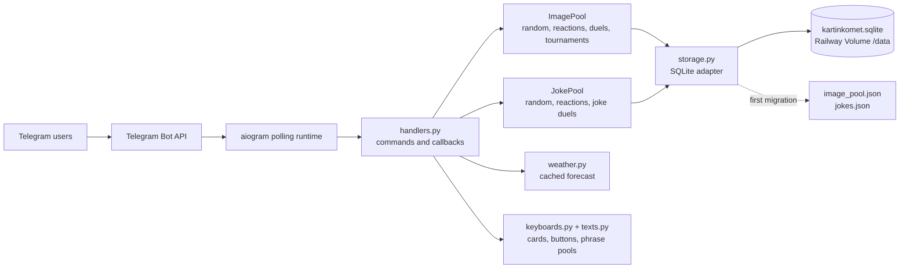
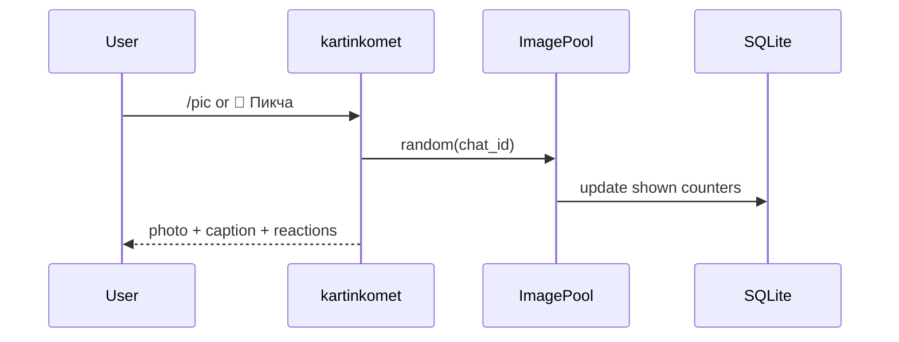
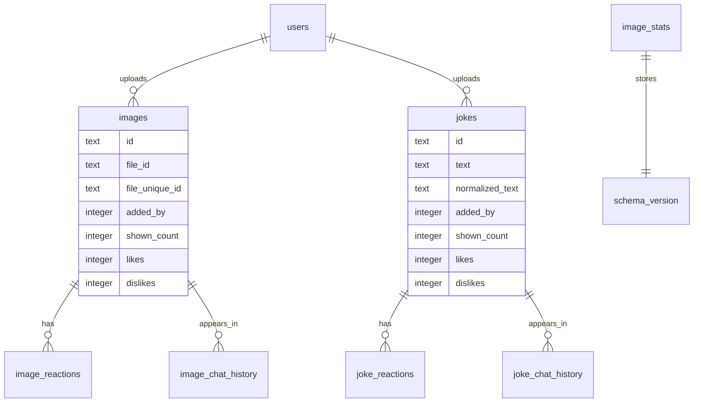

<div align="center">

# kartinkomet

**A Telegram bot for a shared image and joke warehouse: random drops, private uploads, reactions, duels, tournaments, leaderboards, profiles, weather, and maintenance commands**


[Русская версия](README.md)

</div>

## Short Version

`kartinkomet` lives in Telegram groups and private chats. In groups it entertains: random images, random jokes, duels, tournaments, leaderboards, and stats. In private chat it accepts new content into the shared pool.

The key rule: the bot does not store image files. It stores Telegram `file_id` and `file_unique_id`; the real files stay on Telegram's side. Jokes are stored separately from images. The main production storage is SQLite on a Railway Volume.

## Feature Map

| Area | What it does |
| --- | --- |
| 🎲 Random | Images and jokes with per-chat and global anti-repeat memory |
| 📥 Uploads | Images and jokes are uploaded in private chat to avoid Telegram Privacy Mode issues |
| 🤙🏻 / 🖕🏻 | One user has one current reaction, but can switch it |
| ⚖️ Jury rule | `2 🖕🏻` remove an image or joke from the pool |
| ⚔️ Duels | One image duel and one joke duel can run in the same chat at the same time |
| 🏟 Tournament | 4 images, 90 seconds, one champion, no loser deletion |
| 🏆 Leaderboard | Uploader leaderboard without Telegram `@` pings |
| 👤 Profile | User contribution, reactions on their images, achievements, progress |
| 🌦 Weather | Mala Tokmachka weather card with a 10 minute cache |
| 🧰 Maintenance | `/backup`, `/dedupe_user`, `/reset_stats`, visual dedupe script |

## Architecture



The current production runtime is Railway + long polling. The `cloudflare-worker/` directory contains an experimental Workers + D1 serverless version, but the Railway production bot does not depend on it.

## UX Contract

The interface is built around compact cards and compact buttons. The goal is simple: no wall of text, no accidental chaos, and every action should be obvious.

```text
🎛 Пульт

🎲 Выдача       ⚔️ Арены
📦 Склад        🌦 Погода
```

```text
🎲 Выдача

🎲 Пикча        😂 Анекдот
🎛 Назад
```

```text
⚔️ Арены

⚔️ Пикч-бой     🥊 Шутко-бой
🏟 Турнир       📊 Сводка
🎛 Назад
```

```text
📦 Склад

📦 Сводка       📥 Загрузка
🏆 Топ          👤 Мой вклад
🎛 Назад
```

In groups, upload buttons do not accept files directly. They route the user to private chat because it is more reliable with Telegram Privacy Mode and keeps group chats clean.

## Commands

The public Telegram command menu is intentionally short and practical.

| Command | Purpose |
| --- | --- |
| `/start` | Start the bot and show the intro |
| `/menu` | Open the main control panel |
| `/pic` | Send a random image |
| `/joke` | Send a random joke |
| `/duel` | Start a two-image duel |
| `/jokeduel` | Start a two-joke duel |
| `/tournament` | Start a four-image tournament |
| `/weather` | Show Mala Tokmachka weather |
| `/upload_pidor` | Start image upload in private chat |
| `/upload_joke` | Start joke upload in private chat |
| `/stats` | Show warehouse and arena stats |
| `/me` | Show the user's player card |
| `/top` | Show the uploader leaderboard |
| `/help` | Show the command map |

Available, but hidden from the public command menu:

| Command | Purpose |
| --- | --- |
| `/done` | Finish the active upload session |
| `/cancel` | Cancel the active upload session |
| `/count` | Quick image and joke counter |
| `/id` | Show Telegram user ID |

Admin-only maintenance commands for users listed in `ADMIN_USER_IDS`:

| Command | Purpose |
| --- | --- |
| `/backup` | Send SQLite and JSON safety exports to Telegram |
| `/reset_stats` | Reset reactions, views, duels, tournaments, and random memory |
| `/dedupe_user USER_ID` | Remove exact duplicates from a specific uploader |

## Random Engine

The picker is not a blind `choice` from an array. It works as a small anti-repeat engine:

1. excludes items recently shown in the current chat;
2. considers globally fresh deliveries;
3. builds a candidate window from the least-shown records;
4. performs the final pick through weighted `SystemRandom`: fewer views means a better chance;
5. uses separate histories for duels and tournaments so fresh pairs and quartets do not come back immediately.

Small pools can still repeat. Large pools become much less repetitive.

## Workflows

### Images



Image upload:

1. open a private chat with the bot;
2. send `/upload_pidor` or press `📥 Загрузка` -> `📥 Пикчи`;
3. send one image, a batch, an album, or forwarded images;
4. press `✅ Закончить` or send `/done`;
5. cancel with `/cancel` when needed.

Upload throttle: `1000` new images per hour per user. Duplicates and invalid files are counted separately.

### Jokes

`/joke` sends text from a separate pool. The joke is sent as an HTML quote, and reactions use the same `🤙🏻` and `🖕🏻` buttons.

Joke upload:

1. open a private chat with the bot;
2. send `/upload_joke` or press `📥 Загрузка` -> `📝 Анекдоты`;
3. send jokes as text, one joke per message;
4. finish with `/done` or cancel with `/cancel`.

Duplicate jokes are rejected through normalized text: case, extra spaces, and some punctuation do not create a new unique joke.

### Duels

Image duel:

- 2 random images are sent as an album without captions;
- the vote card runs for 60 seconds;
- each user votes once but can switch sides;
- winner stays in the pool;
- losing image is removed;
- ties keep both images alive.

Joke duel:

- 2 random jokes are sent as quotes;
- voting lasts 2 minutes;
- winner stays;
- losing joke is removed;
- long jokes are not meaning-trimmed, they are split into Telegram-safe messages.

Image and joke arenas are independent. One active duel of each type can exist in the same chat.

### Tournament

The tournament selects 4 images and starts a 90 second vote.

Tournaments do not delete losers. They are a showcase, not a court. If there is a champion, it can immediately be sent into a champion duel.

## Data Storage

Main file:

```text
/data/kartinkomet.sqlite
```

Local fallback when `RAILWAY_VOLUME_MOUNT_PATH` is not set:

```text
data/kartinkomet.sqlite
```

Simplified ER diagram:



Legacy files are still supported as first-migration sources:

```text
/data/image_pool.json
/data/jokes.json
```

If SQLite is empty, the bot imports legacy JSON documents, normalizes the data, and continues through proper tables.

## Performance

Important implementation choices:

- pools are loaded into memory on startup;
- fast lookup indexes exist for `id`, `file_id`, `file_unique_id`, and `added_by`;
- reactions are stored as one current vote per user;
- `/stats`, `/top`, and `/me` use caches invalidated after pool changes;
- the random picker selects from a least-shown window without sorting the entire pool;
- all SQLite writes go through one storage layer;
- heavy `Pillow` dependency is moved to `requirements-maintenance.txt` and is not required by the Railway runtime;
- Telegram network errors are logged and should not crash polling;
- stale duel and tournament sessions are cleared on the next activity start.

## Text Pools

All phrases live in `bot/texts.py`.

Current pools include:

- `1550` random image captions;
- `200` upload-start phrases;
- `200` upload-finish phrases;
- `200` empty-pool phrases;
- `100` achievements;
- `600` short image-duel phrases;
- phrase sets for joke duels, tournaments, jury messages, and UI cards.

Image captions stay clean, without technical prefixes.

## Local Development

Requires Python `3.12`.

```bash
python3.12 -m venv .venv
source .venv/bin/activate
python -m pip install --upgrade pip
pip install -r requirements.txt
```

Create `.env`:

```env
BOT_TOKEN=123456:telegram-token
DATABASE_PATH=data/kartinkomet.sqlite
IMAGE_POOL_PATH=data/image_pool.json
JOKE_POOL_PATH=data/jokes.json
TARGET_CHANNEL_ID=
ADMIN_USER_IDS=177117495
```

Run:

```bash
python -m bot
```

Checks:

```bash
python -m compileall bot scripts tests
python -m unittest discover
```

## Railway Production

Railway uses:

```text
Procfile          worker: python -m bot
.python-version  3.12
```

Minimum variables:

```env
BOT_TOKEN=telegram_bot_token
ADMIN_USER_IDS=177117495
```

Recommended variables:

```env
TARGET_CHANNEL_ID=
DATABASE_PATH=/data/kartinkomet.sqlite
IMAGE_POOL_PATH=/data/image_pool.json
JOKE_POOL_PATH=/data/jokes.json
```

Volume mount path:

```text
/data
```

When Railway provides `RAILWAY_VOLUME_MOUNT_PATH`, the bot can build paths inside the mounted volume automatically. Explicit `DATABASE_PATH`, `IMAGE_POOL_PATH`, and `JOKE_POOL_PATH` are still useful for predictable operations.

## Backup And Migration

The safest path:

1. open private chat with the bot;
2. send `/backup`;
3. save the delivered files.

`/backup` sends:

- `kartinkomet.sqlite` - the primary database;
- `image_pool.json` - image legacy safety export when present;
- `jokes.json` - joke legacy safety export when present.

Before stopping Railway or moving to another provider, download SQLite first. Without it, a new bot starts empty or only with whatever can be restored from JSON.

## Maintenance

Exact duplicates from a specific user:

```text
/dedupe_user 1045485205
```

Visual duplicate cleanup:

```bash
pip install -r requirements-maintenance.txt
python scripts/visual_dedupe.py --user-id 1045485205 --dry-run
python scripts/visual_dedupe.py --user-id 1045485205 --apply
```

The script creates a backup next to `image_pool.json`. Run it as a one-off task and avoid active upload windows.

Stats reset:

```text
/reset_stats
```

The command resets reactions, views, duels, tournaments, and random memory. It does not delete pool content.

## Cloudflare Workers

The `cloudflare-worker/` directory contains an experimental Worker:

- webhook endpoint;
- D1 binding `DB`;
- basic `/pic`, `/joke`, `/stats`, `/upload_pidor`, `/upload_joke`;
- reactions and deletion after `2 🖕🏻`.

This is not the current production runtime. A full migration requires moving data into D1 and switching Telegram to webhook mode. The Railway bot keeps running through polling.

## Project Map

```text
bot/
  __main__.py      # aiogram startup, polling, Telegram command menu
  config.py        # env vars and runtime paths
  handlers.py      # commands, callbacks, workflows, state machine
  image_pool.py    # images, random picker, reactions, duels, tournaments, indexes
  joke_pool.py     # jokes, random picker, reactions, duels
  keyboards.py     # inline keyboards and callback layout
  storage.py       # SQLite schema, migrations, legacy fallback
  texts.py         # phrases, achievements, UI copy
  weather.py       # Mala Tokmachka weather with cache

scripts/
  visual_dedupe.py # visual duplicate maintenance

tests/
  test_contract.py # behavioral and text contract checks

cloudflare-worker/
  src/index.js     # experimental Worker runtime
  schema/schema.sql
  wrangler.toml
```

## Operational Checklist

- Run `/backup` before any migration.
- Keep only one active polling runtime for one `BOT_TOKEN`.
- Never commit real tokens.
- Keep uploads in private chat and groups for delivery/games.
- Run visual dedupe with `--dry-run` first.
- After command changes, update `BOT_COMMANDS` in `bot/__main__.py` and this README.
- After storage changes, run `python -m unittest discover`.
