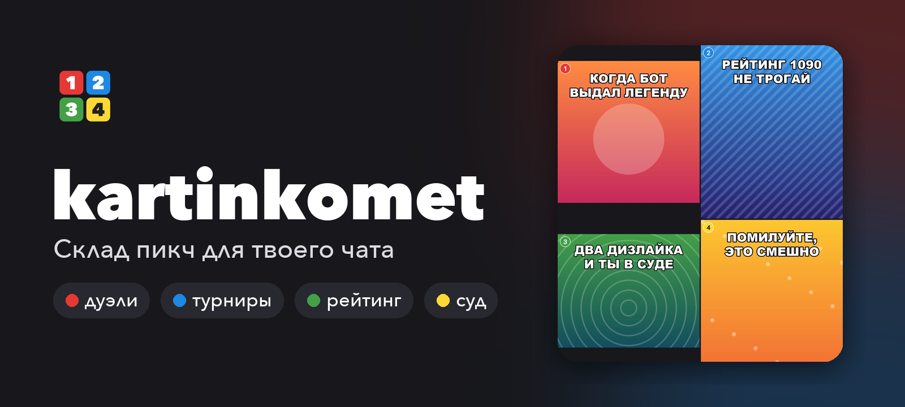
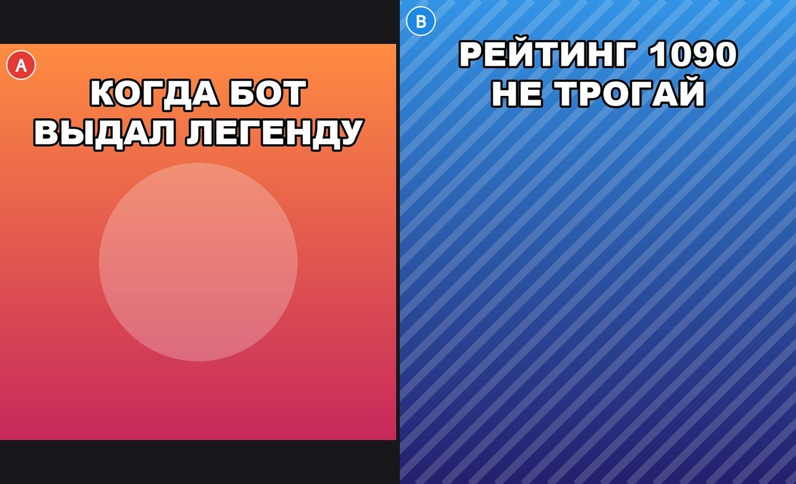
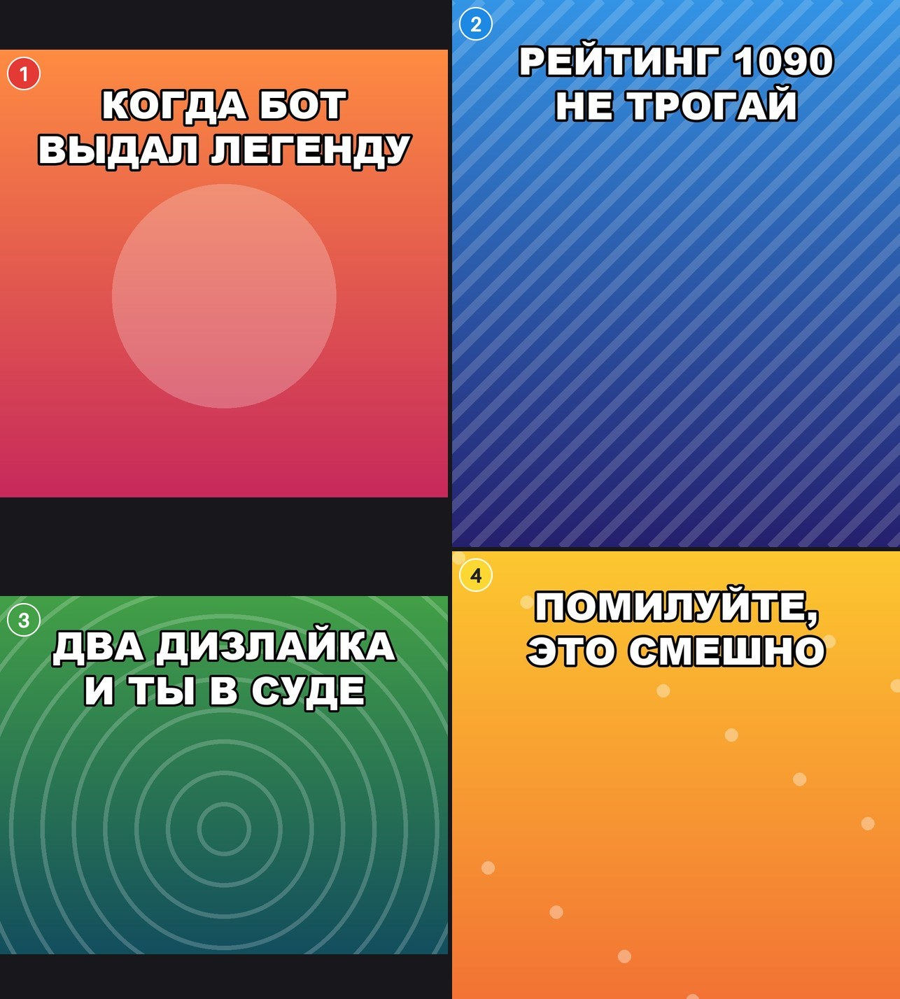

<p align="center">
  
</p>

<h1 align="center">kartinkomet</h1>

<p align="center"><strong>Склад пикч для твоего чата: дуэли с рейтингом, народный суд, казино, боссы, свадьбы и ограбления.</strong></p>

<p align="center">
  <a href="https://t.me/kartinkomet_bot"><strong>Открыть бота ↗</strong></a> ·
  <a href="#-как-играть">Как играть</a> ·
  <a href="#-своя-копия">Запуск</a> ·
  <a href="docs/ARCHITECTURE.md">Архитектура</a>
</p>

<p align="center">
  <a href="https://github.com/StonerHand/kartinkomet-bot/actions/workflows/ci.yml"></a>
  <a href="https://github.com/StonerHand/kartinkomet-bot/releases"></a>
  <a href=".python-version"></a>
  <a href="https://docs.aiogram.dev"></a>
  <a href="https://railway.com"></a>
  <a href="LICENSE"></a>
</p>

<p align="center">
  
</p>

## ✨ Что умеет

**Пикчи и арена**

- 🎲 **Честный рандом.** Одна колода на чат для рандома, дуэлей, турниров и кубка: ни одна пикча не повторится, пока не покажут весь склад, а после круга последние показанные ещё ждут. Дубли одной картинки бот находит по отпечатку и убирает со склада. Иногда выпадают 🆕 свежие загрузки и 🏛 легенды зала славы.
- ⚔️ **Дуэли и турниры.** Пикчи собираются в один коллаж из карточек: сверху цветная плашка с буквой или номером, под ней пикча целиком, ничего не перекрыто. Те же цвета — у строк голосов и у кнопок. Победы двигают рейтинг Elo, чемпионка копит серию.
- 🧬 **Эволюция.** За победы пикча растёт: 🥚 → 🐣 → 🐺 → 🐉 → 🌌.
- 💰 **Ставки на бои.** Тотализатор: банк делят те, кто угадал, коэффициенты видны на карточке.
- ⚖️ **Народный суд и апелляция.** Два 🖕🏻 — и пикча под судом. После казни загрузчик может внести залог и получить повторный суд.

**Монеты**

- 🪙 **Экономика.** Монеты за голоса, угадывания, лайки, игры и квесты; каждому на старт — 1111. Уровень растёт только от заработанного, не от выигранного.
- 🏆 **Сезоны.** Сезон — календарный месяц. Очки — монеты, заработанные игрой; казино и подарки не считаются. Тройка лучших получает значок навсегда, а монеты у всех сгорают до 1111.
- 📈 **Всё от общего пула.** Каждая сумма в игре — цены, награды, штрафы, минимальные ставки, кнопки сумм — привязана к среднему кошельку чата (монеты всех, кто играл последние две недели, включая админов). Чат богатеет — растёт всё сразу и одинаково, так что награда всегда весит одинаково относительно кошелька. Уровни считают базовые монеты, сброс сезона возвращает всё к базе.
- 🎰 **Казино на кубиках Telegram.** Слоты, кости против бота, дартс, баскет, футбол, боулинг; ставка — процент от баланса или своё число. Результат выкидывает сам Telegram. Десятая часть проигрышей копится в общий джекпот чата, и любая игра может сорвать его целиком.
- 🛒 **Лавка.** Щит от суда, буст рейтинга, заказной суд, снятие порчи, награда за голову, воскрешение с кладбища, свой титул.
- 🎁 **Бонус дня, квесты и сундуки.** Серия бонусов, три квеста в день, три челленджа в неделю, сундуки трёх редкостей; в редких — рамки для пикч и титулы.

**Люди**

- 👥 **Подарки, ограбления, свадьбы.** `/give`, `/rob` с шансом и обезьянником, `/marry` с семейным бонусом и разделом имущества при разводе. Кого и сколько бот спрашивает кнопками с именами людей из чата — синтаксис учить не нужно. В пульте всё это собрано в разделе «👥 Люди»; грабить предлагает только тех, кого можно ограбить, а развод сначала переспрашивает.
- 🤺 **Вызовы.** `/challenge 200`: пикчи двух игроков дерутся, чат голосует, победитель забирает банк. `/pvp 200` — то же на костях, дартсе или боулинге. После итога — кнопка реванша и личный счёт.
- 👑 **Статусы.** Короны недели, «голос народа», немезида, 100 ачивок с редкостью и витриной. Профиль в группе видишь только ты.

**Сам по себе**

- 👹 **Боссы и рейды.** Пикча-чудовище на 10 минут: чат бьёт кнопками, добыча по урону. По субботам — рейд до полуночи: с яростью, щитом, лечением и сундуками всем бойцам.
- 📰 **Событие дня.** В 10:00 одно правило ломается до полуночи: чума, амнистия, перевёртыш, налог на богатство и ещё 14.
- 📅 **Расписание.** Пикча дня, босс в 16:00, вечерний суд, итоги недели, бэкап админам.
- 💸 **Великий передел.** Каждый день в 18:00 по Москве у одного игрока забирают все монеты и раздают остальным, кто играл последние две недели, в случайных долях. Раздают не больше десяти обычных кошельков, остальное сгорает. Админов не щадят.
- 🗳 **Кто из нас.** Вопрос про чат, ответы — его люди: «Кто первым сбежит при зомби-апокалипсисе?». Полчаса на голоса, победитель носит титул сутки. Приходит сам в 13:00, свой вопрос — `/who` и текст.
- 💣 **Бомба.** `/bomb` вручает бомбу случайному игроку. Передать её — ответить на чьё-то сообщение, у каждого 15 секунд. На кого рванёт — теряет монеты и носит «Жертву бомбы» сутки.
- 🎬 **Вечернее шоу в 21:00.** Через день: 🏦 ограбление банка — банда из 2–8 человек с ролями проходит три этапа, голосуя за план (чисто — каждому куш, провал — все в обезьянник), или 🏆 большой турнир — восемь пикч на вылет обычными дуэлями, загрузчику чемпионки приз. Вручную — `/heist` и `/cup`, раз в день.
- 🐊 **Крокодил пикчами.** `/croc`: тебе слово, объяснять его можно только пикчами со склада, чат угадывает обычными сообщениями. Угадавшему и объяснявшему — монеты.
- 🎯 **Тема дня.** В 11:00 тема вроде «Ты, когда пришла зарплата», до 20:00 все отвечают своей пикчей, потом полчаса голосования: лучший ответ носит титул сутки.
- 🏷 **Владельцы пикч.** Любую пикчу можно купить в её меню: каждая её победа на арене приносит владельцу монеты, а перекупить её можно только дороже — деньги уходят прошлому хозяину.
- 🤝 **Споры.** `/bet в пятницу половина чата проспит`: чат ставит на «сбудется» или «не сбудется», автор решает, победители делят ставки проигравших.
- 🎮 **Мини-игры и inline.** «Чья пикча?», «Выше-ниже» в личке, «Подпиши пикчу», золотая пикча, колесо фортуны, гороскоп, `@kartinkomet_bot` в любом чате.
- 📊 **Админка.** Состояние бота, бэкап и статистика за неделю: сколько людей и какими механиками пользуются.

**Удобство**

- 📅 **Сегодня в чате.** Кнопка в пульте: что идёт прямо сейчас, расписание дня с галочками и твоё невзятое — бонус, колесо, гороскоп, квесты — с кнопками.
- 🎛 **Личный пульт.** Общий пульт в группе одинаков для всех: что идёт сейчас, что дальше по расписанию, событие дня и сезон. Кнопка «👤 Мой пульт» открывает твой, видный только тебе: монеты, уровень с полоской, что ты ещё не забрал сегодня и кнопка забрать. Лавку, казино, рейтинги и профиль каждый листает в своей копии — чужое нажатие ничего не уводит из-под рук.
- 🤫 **Личное — лично.** Отказы, подсказки, бонус дня, сундуки и вопросы «кого и сколько» видит только тот, кого они касаются; в чат идут события. Где Telegram не даёт ответить лично, подсказки сами удаляются.
- ⚡ **Быстрый отклик.** Живые карточки боёв, судов и боссов перерисовываются не чаще раза в 3,5 секунды на чат и только когда что-то изменилось, поэтому чат не упирается в лимиты Telegram, а команды людей отвечают сразу.

## 📱 Как выглядит

| Дуэль | Турнир |
| :---: | :---: |
|  |  |

Карточка голосования — подпись к коллажу, итог приходит в то же сообщение. У всех карточек один дизайн: заголовок, строка-шутка, факты — каждая строка со своим эмодзи, правила и пояснения — в рамке внизу.

```
⚔️ Дуэль · 0:54
Великая сеча пикч начинается прямо сейчас

🟥 🐣 A · 1 голос  ▰
🟦 🥚 B · 3 голоса  ▰▰▰▰▰

💰 Ставки: 650 монет · A ×13 · B ×1.08

┃ Голоса летят, как стулья на свадьбе
```

```
⚔️ Итог дуэли · 1 : 3
Солнце склада сегодня светит для неё

👑 B · stoner
рейтинг 1017 (+17)

▫️ A · train
рейтинг 1013 (−17)

🎯 Угадали: Михаил, Захар (+4 монеты)
```

## 🎮 Как играть

1. Добавьте бота в групповой чат.
2. Загрузите пикчи в личке: `/upload`, потом фото, альбомы или пересылки. Дубли бот выкинет сам.
3. В чате — `/pic`, `/duel`, `/tournament` или пульт `/menu`.

| Команда | Что делает |
| --- | --- |
| `/menu` | Пульт: всё в одном месте |
| `/pic` · `/duel` · `/tournament` | Рандом · дуэль · турнир |
| `/daily` · `/quests` | Бонус дня · квесты, челленджи и сундуки |
| `/casino` · `/spin 100` · `/dice 100` | Казино · слоты · кости; ещё `/darts`, `/basket`, `/football`, `/bowling` |
| `/shop` | Лавка (а под каждой пикчей — кнопка 🛒) |
| `/boss` | Призвать босса |
| `/challenge 200` · `/pvp 200` | Вызов на дуэль пикч · кости, дартс или боулинг 1 на 1 |
| `/give` · `/rob` | Подарок · ограбление. Бот спросит кого и сколько кнопками; можно сразу ответом на сообщение или с ником: `/give vasya 100` |
| `/marry` · `/divorce` | Свадьба · развод |
| `/whose` · `/higher` | Чья пикча? · выше-ниже (в личке) |
| `/caption` · `/wheel` · `/horoscope` | Подпиши пикчу · колесо фортуны · гороскоп |
| `/top` · `/me` | Рейтинги, сезон и «Зал сезонов» · своя карточка |
| `/upload` | Загрузка в личке |
| `/help` · `/admin` | Правила · админка |

## 🛠 Своя копия

Нужны Python 3.12 и токен бота от [@BotFather](https://t.me/BotFather).

```bash
git clone https://github.com/StonerHand/kartinkomet-bot.git
cd kartinkomet-bot
python3.12 -m venv .venv && source .venv/bin/activate
pip install -r requirements.txt
cp .env.example .env   # впишите BOT_TOKEN и свой ID в ADMIN_USER_IDS
python -m bot
```

Inline-режим включается один раз в @BotFather: `/setinline`. Часовой пояс событий — `BOT_TZ_OFFSET` (по умолчанию `3`, Москва).

Для продакшена: Railway, worker `python -m bot` и volume под базу. Бот держится примерно в 70 МБ памяти (aiogram загружается лениво, см. `bot/telegram/lean.py`) и укладывается в бесплатный тариф.

## 🧩 Как устроено

```
Telegram ──▶ aiogram (long polling) ──▶ bot/scenarios   что делает команда, кнопка или расписание
                                          │               bot/live        живые карточки: отсчёт и итоги
                                          │               bot/ui          как это выглядит
                                          ▼
                                     bot/game ──▶ bot/rules   правила без I/O
                                          │
                                          ▼
                                       bot/db ──▶ SQLite (WAL) на volume
```

Картинки бот не хранит — только Telegram `file_id`, рейтинги и статистику. Активные бои и суды живут в базе и переживают рестарт; после долгого простоя бот не отвечает разом на накопившиеся старые команды. Каждый раздел кода импортирует только те, что ниже него, и CI это проверяет (`lint-imports`), а схема слоёв в [архитектуре](docs/ARCHITECTURE.md#структура) строится из настоящих импортов. CI гоняет линтер и 384 теста: сквозные сценарии с фейковым Telegram, сотни одновременных нажатий и проверку дизайна каждого сообщения — эмодзи в начале каждого блока, никаких слипшихся строк на ширине телефона. `python scripts/load_test.py` прогоняет нагрузку с задержкой сети, `python scripts/dump_screens.py screens.html` показывает все сообщения бота пузырями шириной с телефон. Подробности — в [архитектуре](docs/ARCHITECTURE.md), изменения — в [релизах](https://github.com/StonerHand/kartinkomet-bot/releases).

## 📄 Лицензия

[MIT](LICENSE) © StonerHand

<p align="center"><a href="https://t.me/kartinkomet_bot"><strong>Устроить первую дуэль ↗</strong></a></p>
