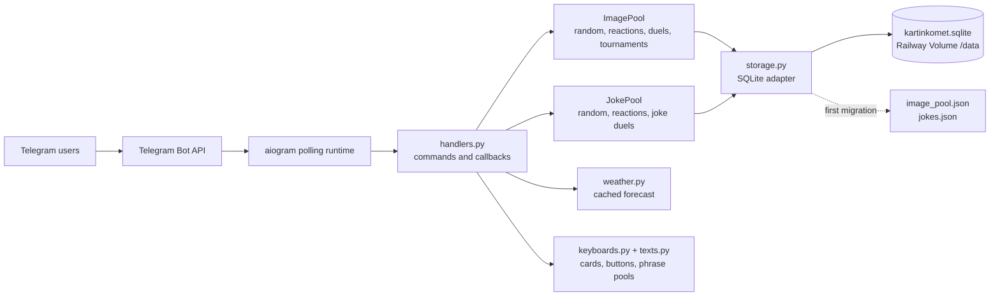
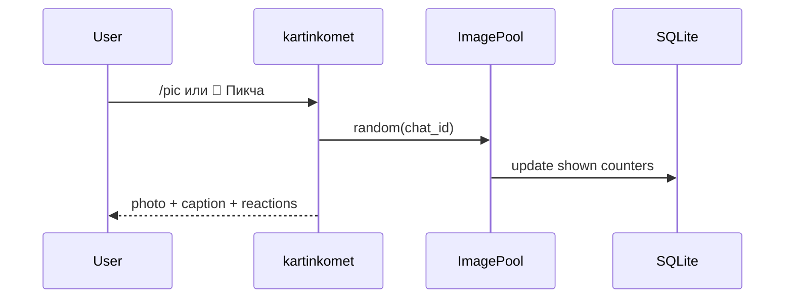
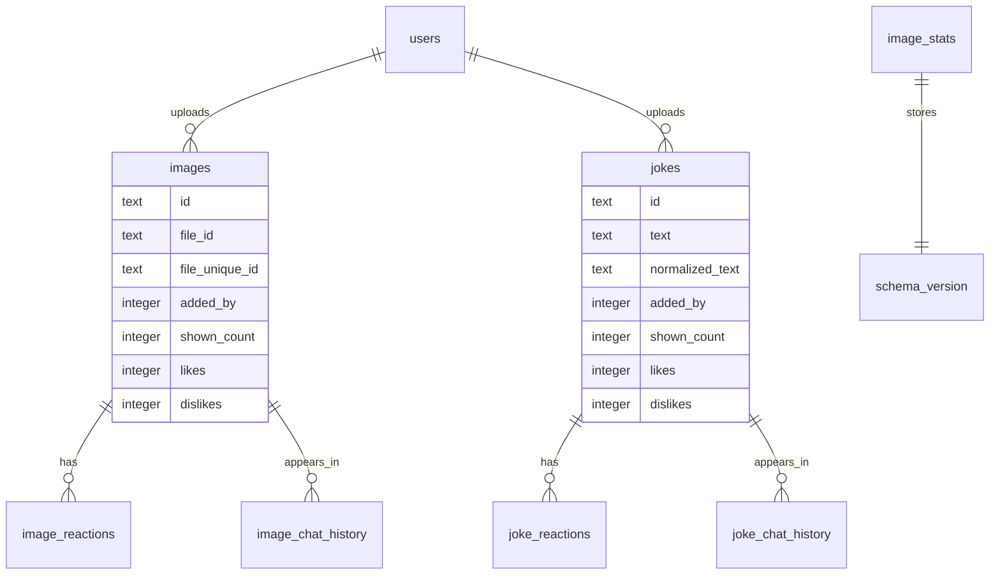

<div align="center">

# kartinkomet

**Telegram-бот для общего склада пикч и анекдотов: рандом, загрузка в личке, реакции, дуэли, турниры, топы, профили, погода и maintenance-команды**


[English README](README.en.md)

</div>

## Коротко

`kartinkomet` живёт в Telegram-группах и личке. В группах он развлекает: выдаёт случайные пикчи и анекдоты, запускает дуэли, турниры, показывает топы и статистику. В личке он принимает контент в общий пул.

Главный принцип: бот не хранит сами изображения. Он сохраняет только Telegram `file_id` и `file_unique_id`, а файлы физически остаются на стороне Telegram. Анекдоты живут отдельно от пикч. Основное хранилище - SQLite на Railway Volume.

## Фичи

| Блок | Что умеет |
| --- | --- |
| 🎲 Рандом | Пикчи и анекдоты с анти-повторами по чату и глобальной памяти |
| 📥 Загрузка | Пикчи и анекдоты загружаются в личке, чтобы Telegram Privacy Mode не ломал приём файлов |
| 🤙🏻 / 🖕🏻 | Один пользователь голосует один раз, но может перевыбрать реакцию |
| ⚖️ Народный суд | `2 🖕🏻` удаляют пикчу или анекдот из пула |
| ⚔️ Дуэли | Одна пикчевая и одна анекдотная дуэль могут идти в одном чате одновременно |
| 🏟 Турнир | 4 пикчи, 90 секунд, один чемпион, без удаления проигравших |
| 🏆 Топ | Лидерборд загрузчиков без Telegram-пингов через `@` |
| 👤 Профиль | Вклад пользователя, реакции на его пикчи, достижения и прогресс |
| 🌦 Погода | Карточка погоды для Малой Токмачки с кэшем на 10 минут |
| 🧰 Maintenance | `/backup`, `/dedupe_user`, `/reset_stats`, visual dedupe через отдельный скрипт |

## Архитектура



Боевой режим сейчас - Railway + long polling. Папка `cloudflare-worker/` содержит экспериментальный серверлесс-вариант Workers + D1, но production-бот на Railway от него не зависит.

## UX-Контракт

Интерфейс бота строится вокруг коротких карточек и компактных кнопок. Цель - чтобы чат не превращался в простыню, а каждое действие было понятно с первого взгляда.

```text
🎛 Пульт

🎲 Выдача       ⚔️ Арены
📦 Склад        🌦 Погода
```

```text
🎲 Выдача

🎲 Пикча        😂 Анекдот
🎛 Назад
```

```text
⚔️ Арены

⚔️ Пикч-бой     🥊 Шутко-бой
🏟 Турнир       📊 Сводка
🎛 Назад
```

```text
📦 Склад

📦 Сводка       📥 Загрузка
🏆 Топ          👤 Мой вклад
🎛 Назад
```

Загрузка в группе не принимает файлы напрямую. Кнопка показывает маршрут в личку, потому что так стабильнее для Telegram Privacy Mode и не засоряет общий чат.

## Команды

Публичное меню команд держится коротким и прикладным.

| Команда | Назначение |
| --- | --- |
| `/start` | Запустить бота и показать приветствие |
| `/menu` | Открыть главный пульт |
| `/pic` | Выдать случайную пикчу |
| `/joke` | Выдать случайный анекдот |
| `/duel` | Запустить дуэль двух пикч |
| `/jokeduel` | Запустить дуэль двух анекдотов |
| `/tournament` | Запустить турнир четырёх пикч |
| `/weather` | Показать погоду Малой Токмачки |
| `/upload_pidor` | Включить загрузку пикч в личке |
| `/upload_joke` | Включить загрузку анекдотов в личке |
| `/stats` | Показать сводку склада и арен |
| `/me` | Показать личную карточку игрока |
| `/top` | Показать топ загрузчиков |
| `/help` | Показать карту команд |

Работают, но не вынесены в публичное меню:

| Команда | Назначение |
| --- | --- |
| `/done` | Завершить активную загрузку |
| `/cancel` | Отменить активную загрузку |
| `/count` | Быстрый счётчик пикч и анекдотов |
| `/id` | Показать Telegram user ID |

Служебные команды для админов из `ADMIN_USER_IDS`:

| Команда | Назначение |
| --- | --- |
| `/backup` | Прислать SQLite-базу и JSON-страховки в Telegram |
| `/reset_stats` | Сбросить реакции, показы, дуэли и память рандома |
| `/dedupe_user USER_ID` | Убрать точные дубли конкретного загрузчика |

## Рандом

Рандом не делает слепой `choice` по массиву. Он работает как маленький анти-баянный движок:

1. исключает недавно показанные записи в текущем чате;
2. учитывает глобально свежие выдачи;
3. выбирает окно из наименее показанных кандидатов;
4. финально выбирает через `SystemRandom` с весами: чем меньше показов, тем выше шанс;
5. для дуэлей и турниров использует отдельные истории, чтобы свежие пары и четвёрки не возвращались сразу.

Для маленького пула повторы всё равно возможны. Для большого пула бот заметно реже ходит по одному кругу.

## Сценарии

### Пикчи



Загрузка пикч:

1. открыть личку с ботом;
2. отправить `/upload_pidor` или нажать `📥 Загрузка` -> `📥 Пикчи`;
3. отправить одну пикчу, пачку, альбом или пересланные изображения;
4. нажать `✅ Закончить` или отправить `/done`;
5. при необходимости отменить через `/cancel`.

Лимит загрузки: `1000` новых пикч в час на пользователя. Дубли и невалидные файлы считаются отдельно.

### Анекдоты

`/joke` выдаёт текст из отдельного пула. Текст отправляется HTML-цитатой, реакции идут теми же кнопками `🤙🏻` и `🖕🏻`.

Загрузка анекдотов:

1. открыть личку с ботом;
2. отправить `/upload_joke` или нажать `📥 Загрузка` -> `📝 Анекдоты`;
3. отправлять анекдоты текстом, один анекдот на сообщение;
4. завершить через `/done` или отменить через `/cancel`.

Дубли анекдотов отсекаются по нормализованному тексту: регистр, лишние пробелы и часть пунктуации не создают новый уникальный текст.

### Дуэли

Пикчевая дуэль:

- 2 случайные пикчи отправляются альбомом без подписей;
- карточка голосования живёт 60 секунд;
- каждый пользователь голосует один раз, но может сменить сторону;
- победитель остаётся в пуле;
- проигравшая пикча удаляется;
- при ничьей обе пикчи остаются.

Анекдотная дуэль:

- 2 случайных анекдота отправляются цитатами;
- голосование длится 2 минуты;
- победитель остаётся;
- проигравший анекдот удаляется;
- длинные анекдоты не режутся по смыслу, а дробятся на безопасные Telegram-сообщения.

Пикчевая и анекдотная арены независимы. В одном чате может идти одна дуэль каждого типа.

### Турнир

Турнир выбирает 4 пикчи и запускает голосование на 90 секунд.

Турнир не удаляет проигравших. Это витрина, а не суд. Если победитель есть, его можно сразу отправить в дуэль чемпиона.

## Хранение данных

Основной файл:

```text
/data/kartinkomet.sqlite
```

Если `RAILWAY_VOLUME_MOUNT_PATH` не задан, локальный fallback:

```text
data/kartinkomet.sqlite
```

ER-схема в упрощённом виде:



Старые файлы поддерживаются как источник первой миграции:

```text
/data/image_pool.json
/data/jokes.json
```

Если SQLite пустой, бот импортирует старые JSON-документы, нормализует данные и дальше работает через таблицы.

## Производительность

Ключевые решения:

- пул загружается в память при старте;
- быстрые lookup-индексы по `id`, `file_id`, `file_unique_id`, `added_by`;
- реакции хранятся как один текущий голос пользователя;
- `/stats`, `/top`, `/me` используют кэш и инвалидируются после изменений;
- random picker выбирает из least-shown окна без полной сортировки большого пула;
- SQLite-запись идёт через один storage-слой;
- тяжёлый `Pillow` вынесен в `requirements-maintenance.txt` и не нужен боевому Railway runtime;
- сетевые ошибки Telegram логируются и не должны ронять polling;
- stale-сессии дуэлей и турниров очищаются при следующем запуске активности.

## Текстовые пулы

Все фразы лежат в `bot/texts.py`.

Сейчас внутри:

- `1550` caption-фраз для случайных пикч;
- `200` стартовых фраз загрузки;
- `200` фраз завершения загрузки;
- `200` фраз пустого пула;
- `100` достижений;
- `600` коротких фраз для пикчевых дуэлей;
- наборы фраз для анекдотных дуэлей, турниров, народного суда и UI-карточек.

Caption под пикчами чистый, без технических приставок.

## Локальный запуск

Требуется Python `3.12`.

```bash
python3.12 -m venv .venv
source .venv/bin/activate
python -m pip install --upgrade pip
pip install -r requirements.txt
```

Создайте `.env`:

```env
BOT_TOKEN=123456:telegram-token
DATABASE_PATH=data/kartinkomet.sqlite
IMAGE_POOL_PATH=data/image_pool.json
JOKE_POOL_PATH=data/jokes.json
TARGET_CHANNEL_ID=
ADMIN_USER_IDS=177117495
```

Запуск:

```bash
python -m bot
```

Проверки:

```bash
python -m compileall bot scripts tests
python -m unittest discover
```

## Railway Production

Railway использует:

```text
Procfile          worker: python -m bot
.python-version  3.12
```

Минимальные переменные:

```env
BOT_TOKEN=telegram_bot_token
ADMIN_USER_IDS=177117495
```

Рекомендуемые переменные:

```env
TARGET_CHANNEL_ID=
DATABASE_PATH=/data/kartinkomet.sqlite
IMAGE_POOL_PATH=/data/image_pool.json
JOKE_POOL_PATH=/data/jokes.json
```

Volume mount path:

```text
/data
```

Если Railway прокидывает `RAILWAY_VOLUME_MOUNT_PATH`, бот сам соберёт пути внутри volume. Явные `DATABASE_PATH`, `IMAGE_POOL_PATH`, `JOKE_POOL_PATH` можно оставить для полной предсказуемости.

## Бэкап и перенос

Самый простой путь:

1. открыть личку с ботом;
2. отправить `/backup`;
3. сохранить полученные файлы.

Команда `/backup` отправляет:

- `kartinkomet.sqlite` - основная база;
- `image_pool.json` - legacy-страховка пикч, если файл есть;
- `jokes.json` - legacy-страховка анекдотов, если файл есть.

Перед остановкой Railway или переездом на другой сервис сначала заберите SQLite. Без него новый бот стартует пустым или только с тем, что удастся восстановить из JSON.

## Maintenance

Точные дубли конкретного пользователя:

```text
/dedupe_user 1045485205
```

Визуальная чистка дублей:

```bash
pip install -r requirements-maintenance.txt
python scripts/visual_dedupe.py --user-id 1045485205 --dry-run
python scripts/visual_dedupe.py --user-id 1045485205 --apply
```

Скрипт создаёт backup рядом с `image_pool.json`. Запускать лучше разово и не во время активной загрузки.

Сброс статистики:

```text
/reset_stats
```

Команда сбрасывает реакции, показы, дуэли, турниры и память рандома. Контент из пула не удаляется.

## Cloudflare Workers

В папке `cloudflare-worker/` лежит отдельный экспериментальный Worker:

- webhook endpoint;
- D1 binding `DB`;
- базовые команды `/pic`, `/joke`, `/stats`, `/upload_pidor`, `/upload_joke`;
- реакции и удаление после `2 🖕🏻`.

Это не текущий production runtime. Для полноценного переезда нужно отдельно перенести данные в D1 и переключить Telegram webhook. Railway-бот продолжает работать через polling.

## Структура проекта

```text
bot/
  __main__.py      # запуск aiogram, polling, Telegram command menu
  config.py        # env vars и runtime paths
  handlers.py      # команды, callbacks, сценарии, state machine
  image_pool.py    # пикчи, random picker, реакции, дуэли, турниры, индексы
  joke_pool.py     # анекдоты, random picker, реакции, дуэли
  keyboards.py     # inline-клавиатуры и callback layout
  storage.py       # SQLite schema, миграции, legacy fallback
  texts.py         # фразы, достижения, UI copy
  weather.py       # погода Малой Токмачки с кэшем

scripts/
  visual_dedupe.py # maintenance-чистка визуальных дублей

tests/
  test_contract.py # контрактные проверки поведения и текстов

cloudflare-worker/
  src/index.js     # experimental Worker runtime
  schema/schema.sql
  wrangler.toml
```

## Операционный чеклист

- Перед любым переездом выполнить `/backup`.
- Держать только один активный polling runtime с одним `BOT_TOKEN`.
- Не хранить реальные токены в git.
- Загрузку держать в личке, а группы использовать для выдачи и игр.
- Для чистки визуальных дублей сначала запускать `--dry-run`.
- После изменения команд обновлять `BOT_COMMANDS` в `bot/__main__.py` и README.
- После изменения storage прогонять `python -m unittest discover`.
