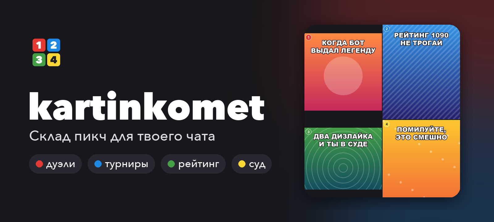
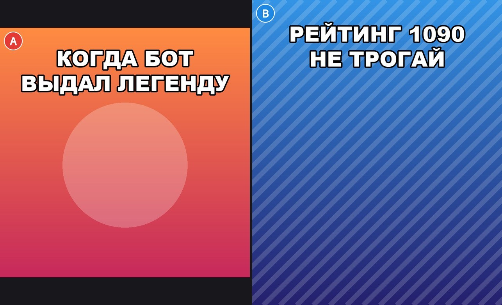
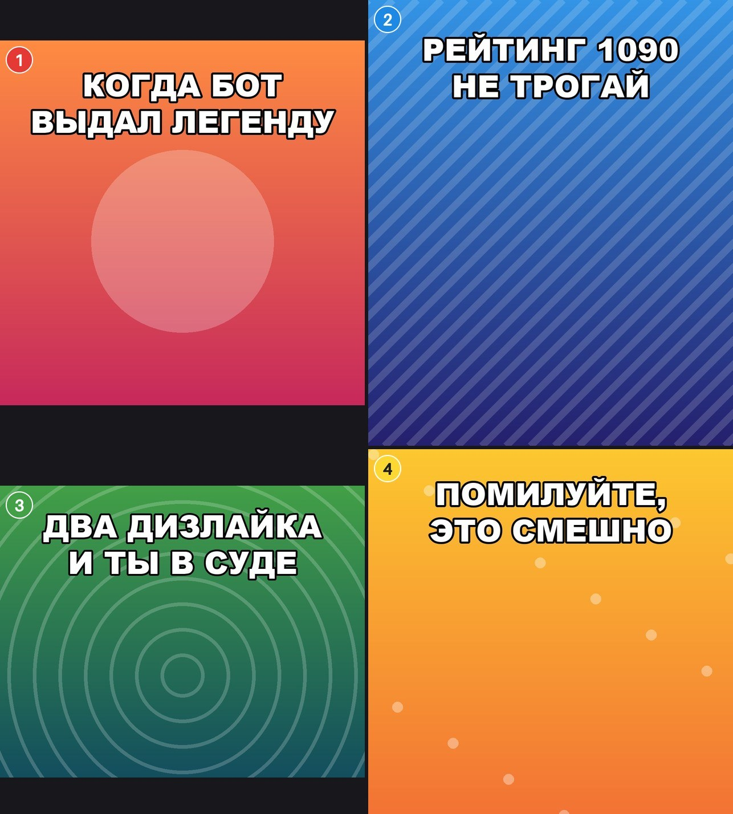

<p align="center">
  
</p>

<h1 align="center">kartinkomet</h1>

<p align="center"><strong>Склад пикч для твоего чата: дуэли с рейтингом, турниры и народный суд.</strong></p>

<p align="center">
  <a href="https://t.me/kartinkomet_bot"><strong>Открыть бота ↗</strong></a> ·
  <a href="#-как-играть">Как играть</a> ·
  <a href="#-своя-копия">Запуск</a> ·
  <a href="docs/ARCHITECTURE.md">Архитектура</a>
</p>

<p align="center">
  <a href="https://github.com/StonerHand/kartinkomet-bot/actions/workflows/ci.yml"></a>
  <a href="https://github.com/StonerHand/kartinkomet-bot/releases"></a>
  <a href=".python-version"></a>
  <a href="https://docs.aiogram.dev"></a>
  <a href="https://railway.com"></a>
  <a href="LICENSE"></a>
</p>

<p align="center">
  
</p>

## ✨ Что умеет

- 🎲 **Честный рандом.** Колода без повторов, пока не покажут все. Иногда выпадают 🆕 свежие загрузки и 🏛 легенды зала славы.
- ⚔️ **Дуэли и турниры.** Пикчи склеиваются в один коллаж с цветными метками, голосование — кнопками прямо под ним. Победы двигают рейтинг Elo.
- 👑 **Серии чемпиона.** Победительница выходит снова и копит серию; на 3, 5 и 10 победах — объявления.
- ⚖️ **Народный суд.** Два 🖕🏻 — и пикча на скамье подсудимых. Казнить или помиловать решает чат, загрузчик может сказать последнее слово.
- 🏛 **Зал славы, дно и кладбище.** Лучшие по рейтингу, худшие под суд, казнённые с причиной смерти.
- 📅 **Само по расписанию.** Пикча дня, вечерний суд над худшей и итоги недели.
- 🏆 **Топы и 30 ачивок.** Загрузчики, любимцы публики, палачи, серии. Профиль в группе видишь только ты.
- 🔎 **Inline-режим.** `@kartinkomet_bot` в любом чате — пикча со склада.

## 📱 Как выглядит

| Дуэль | Турнир |
| :---: | :---: |
|  |  |

Карточка голосования — подпись к коллажу, итог приходит в то же сообщение:

```
⚔️ ДУЭЛЬ · ⏳ 0:54
│ Великая сеча пикч начинается прямо сейчас

🅰️ 1  🟥
🅱️ 3  🟦🟦🟦🟦🟦

🗳 4 голоса · жми кнопку
```

```
⚔️ ИТОГ ДУЭЛИ · 1 : 3

👑 🅱️ stoner · ⭐ 1017 (+17)
▫️ 🅰️ train · ⭐ 1013 (−17)

│ Солнце склада сегодня светит для неё
```

## 🎮 Как играть

1. Добавьте бота в групповой чат.
2. Загрузите пикчи в личке: `/upload`, потом фото, альбомы или пересылки. Дубли бот выкинет сам.
3. В чате — `/pic`, `/duel`, `/tournament` или пульт `/menu`.

| Команда | Что делает |
| --- | --- |
| `/pic` | Случайная пикча |
| `/duel` · `/tournament` | Дуэль двух · турнир четырёх |
| `/menu` | Пульт: зал славы, дно, кладбище, топы, правила |
| `/top` · `/me` | Топы · своя карточка |
| `/upload` | Загрузка в личке |
| `/help` | Правила |
| `/admin` | Для админов: бэкап, health, события, сброс статистики |

## 🛠 Своя копия

Нужны Python 3.12 и токен бота от [@BotFather](https://t.me/BotFather).

```bash
git clone https://github.com/StonerHand/kartinkomet-bot.git
cd kartinkomet-bot
python3.12 -m venv .venv && source .venv/bin/activate
pip install -r requirements.txt
cp .env.example .env   # впишите BOT_TOKEN и свой ID в ADMIN_USER_IDS
python -m bot
```

Inline-режим включается один раз в @BotFather: `/setinline`. Часовой пояс событий — `BOT_TZ_OFFSET` (по умолчанию `3`, Москва).

Для продакшена: Railway, worker `python -m bot` и volume под базу. Бот держится в ~100 МБ памяти и укладывается в бесплатный тариф.

## 🧩 Как устроено

```
Telegram ──▶ aiogram (long polling) ──▶ bot/tg   карточки, кнопки, таймеры, расписание
                                          │
                                          ▼
                                     bot/game.py ──▶ bot/core   колода, Elo, арена, суд, ачивки
                                          │
                                          ▼
                                 bot/db ──▶ SQLite (WAL) на volume
```

Картинки бот не хранит — только Telegram `file_id`, рейтинги и статистику. Активные бои и суды живут в базе и переживают рестарт. CI гоняет линтер и 86 тестов, включая сквозные сценарии с фейковым Telegram. Подробности — в [архитектуре](docs/ARCHITECTURE.md), изменения — в [релизах](https://github.com/StonerHand/kartinkomet-bot/releases).

## 📄 Лицензия

[MIT](LICENSE) © StonerHand

<p align="center"><a href="https://t.me/kartinkomet_bot"><strong>Устроить первую дуэль ↗</strong></a></p>
