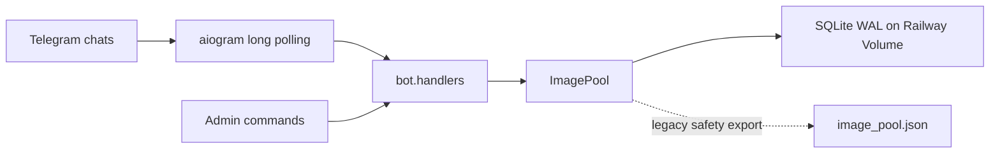
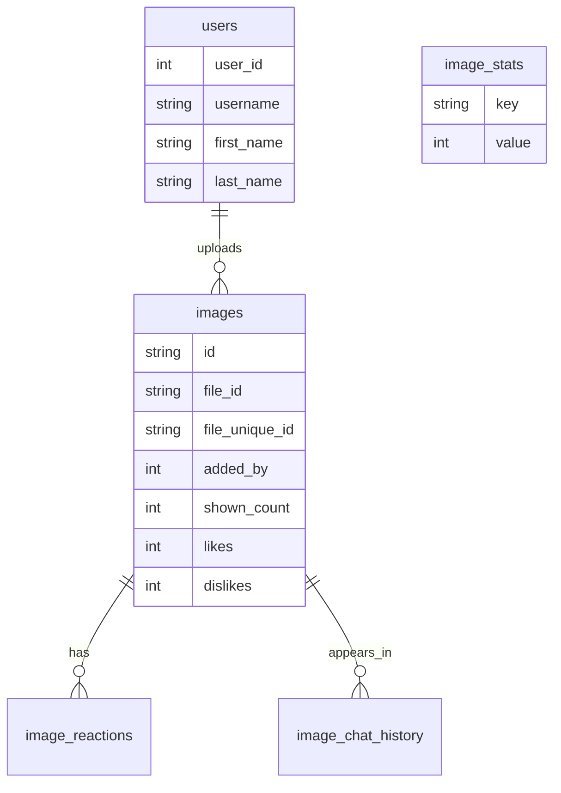

# kartinkomet-bot

**Telegram-бот для общего склада пикч: рандомная выдача, приватная загрузка, реакции, дуэли, турниры, топы и админские maintenance-команды**


`kartinkomet` живёт в Telegram-группах и личке. В группах он выдаёт случайные пикчи, запускает пикчевые дуэли и турниры, показывает статистику и топ загрузчиков. В личке он принимает новые изображения в общий пул.

Главное правило: бот **не хранит сами картинки**. Он сохраняет Telegram `file_id` и `file_unique_id`, а физические файлы остаются на стороне Telegram. На сервере лежит только база с идентификаторами, реакциями, историей выдачи и статистикой.

## Возможности

| Раздел | Что делает |
| --- | --- |
| 🎲 Рандом | Выдаёт случайную пикчу из пула с анти-повторами по чату и общей памяти |
| 📥 Загрузка | Принимает фото, пачки, альбомы и пересланные изображения в личке |
| 🤙🏻 / 🖕🏻 | Реакции учитываются по одному голосу на человека, голос можно перевыбрать |
| ⚖️ Народный суд | `2 🖕🏻` удаляют пикчу из пула |
| ⚔️ Дуэль | Две пикчи, голосование 60 секунд, проигравшая удаляется |
| 🏟 Турнир | Четыре пикчи, голосование 90 секунд, победитель получает витрину, никто не удаляется |
| 📊 Статы | Склад, выдачи, реакции, дуэли, турниры и активные арены |
| 🏆 Топ | Лидерборд загрузчиков с Telegram-именами и титулами |
| 👤 Профиль | Личный вклад пользователя, реакции на его пикчи и достижения |
| 🧹 Maintenance | Бэкап, сброс статистики и чистка дублей по пользователю для админов |

## Архитектура



Production-режим: **Railway + long polling + SQLite на Volume**. Это простой и предсказуемый запуск без вебхуков, доменов и внешней БД.

## Команды

| Команда | Назначение |
| --- | --- |
| `/start` | Стартовое сообщение и главный пульт |
| `/menu` | Открыть главный пульт |
| `/pic` | Выдать случайную пикчу |
| `/duel` | Запустить дуэль двух пикч |
| `/tournament` | Запустить турнир четырёх пикч |
| `/upload_pidor` | Включить загрузку пикч в личке |
| `/stats` | Показать сводку склада и арен |
| `/count` | Быстрый счётчик склада |
| `/me` | Личная карточка пользователя |
| `/top` | Топ загрузчиков пикч |
| `/help` | Карта команд |

Скрытые админские команды:

| Команда | Назначение |
| --- | --- |
| `/backup` | Отправить SQLite-бэкап и JSON-страховку в личку админу |
| `/reset_stats` | Сбросить показы, реакции и память рандома |
| `/dedupe_user <telegram_id>` | Удалить точные дубли конкретного загрузчика |
| `/id` | Показать Telegram user ID |

## UX-логика

### Главный пульт

```text
🎲 Рандом      ⚔️ Арены
📦 Склад       📥 Загрузка
```

В группе кнопка загрузки объясняет, что пополнять склад надо в личке. Это стабильнее: Telegram Privacy Mode не мешает боту видеть фотографии, альбомы и пересланные изображения.

### Загрузка

1. Открыть личку с ботом
2. Отправить `/upload_pidor` или нажать `📥 Начать загрузку`
3. Кидать фото, пачки, альбомы или пересланные изображения
4. Завершить кнопкой `✅ Закончить` или командой `/done`
5. Отменить кнопкой `❌ Отмена` или командой `/cancel`

Бот сохраняет только `file_id` и `file_unique_id`. Дубликаты по `file_unique_id` и `file_id` отсекаются сразу. Лимит загрузки: `1000` новых пикч в час на пользователя.

### Рандом

Алгоритм выдачи не просто берёт случайную строку из базы:

- исключает недавние выдачи в текущем чате;
- учитывает глобальные недавние показы;
- отдаёт приоритет менее показанным пикчам;
- выбирает из окна кандидатов, чтобы пул не зацикливался на одних и тех же картинках.

### Дуэли и турниры

Дуэль:

- выбирает две пикчи;
- отправляет их альбомом;
- даёт 60 секунд на голосование;
- при победе удаляет проигравшую;
- при ничьей оставляет обе.

Турнир:

- выбирает четыре пикчи;
- даёт 90 секунд на голосование;
- показывает чемпиона;
- ничего не удаляет.

Защита от хаоса:

- в одном чате не запускается две одинаковые активные арены;
- дуэль и турнир могут идти параллельно, потому что это разные арены;
- зависшие сессии очищаются по таймеру;
- повторный тап по той же кнопке не ломает логику и не накручивает голос.

## Хранилище

Основная база:

```text
/data/kartinkomet.sqlite
```

Legacy JSON-страховка:

```text
/data/image_pool.json
```

SQLite работает в WAL-режиме:

- `busy_timeout=30000`;
- `foreign_keys=ON`;
- `journal_mode=WAL`;
- `synchronous=NORMAL`.

База содержит:



## Railway

Минимальные переменные:

```env
BOT_TOKEN=123456:telegram-token
RAILWAY_VOLUME_MOUNT_PATH=/data
ADMIN_USER_IDS=177117495
```

Опционально:

```env
DATABASE_PATH=/data/kartinkomet.sqlite
IMAGE_POOL_PATH=/data/image_pool.json
TARGET_CHANNEL_ID=
```

`Procfile`:

```procfile
worker: python -m bot
```

Railway должен иметь Volume, примонтированный в `/data`. Без Volume база будет жить только внутри контейнера и пропадёт при пересоздании окружения.

## Локальный запуск

```bash
python3.12 -m venv .venv
source .venv/bin/activate
python -m pip install --upgrade pip
pip install -r requirements.txt
cp .env.example .env
python -m bot
```

`.env`:

```env
BOT_TOKEN=123456:telegram-token
DATABASE_PATH=data/kartinkomet.sqlite
IMAGE_POOL_PATH=data/image_pool.json
ADMIN_USER_IDS=177117495
```

## Проверка

```bash
.venv/bin/python -m compileall bot scripts tests
.venv/bin/python -m unittest
```

Тесты проверяют:

- публичные команды;
- отсутствие удалённых фич в меню и текстах;
- SQLite-схему;
- реакции и перевыбор голоса;
- анти-повтор рандома;
- удаление проигравшей пикчи в дуэли;
- турнирную логику;
- клавиатуры;
- визуальную чистку дублей.

## Maintenance

### Бэкап

```text
/backup
```

Бот отправляет админу:

- `kartinkomet.sqlite`;
- `image_pool.json`, если файл существует.

### Сброс статистики

```text
/reset_stats
```

Сбрасывает:

- показы;
- реакции;
- память недавних выдач;
- статистику дуэлей и турниров.

Пул пикч остаётся на месте.

### Чистка дублей пользователя

```text
/dedupe_user 1045485205
```

Команда удаляет точные дубли конкретного пользователя по `file_unique_id` и `file_id`. Перед массовой визуальной чисткой можно использовать скрипт:

```bash
python scripts/visual_dedupe.py --user-id 1045485205 --dry-run --threshold 3
```

## Структура проекта

```text
bot/
  __main__.py     # запуск, команды Telegram, подключение роутера
  config.py       # env-конфиг
  handlers.py     # команды, callback-и, UI-тексты, арены
  image_pool.py   # пул пикч, рандом, реакции, статистика
  keyboards.py    # inline-клавиатуры
  storage.py      # SQLite + legacy JSON
  texts.py        # большие наборы фраз
scripts/
  visual_dedupe.py
tests/
  test_contract.py
```

## Текущее состояние

Бот сфокусирован на одной задаче и делает её нормально: **общий склад пикч, рандом, голосования и арены**. Лишние экспериментальные ветки удалены, чтобы код был легче, стабильнее и проще в поддержке.
