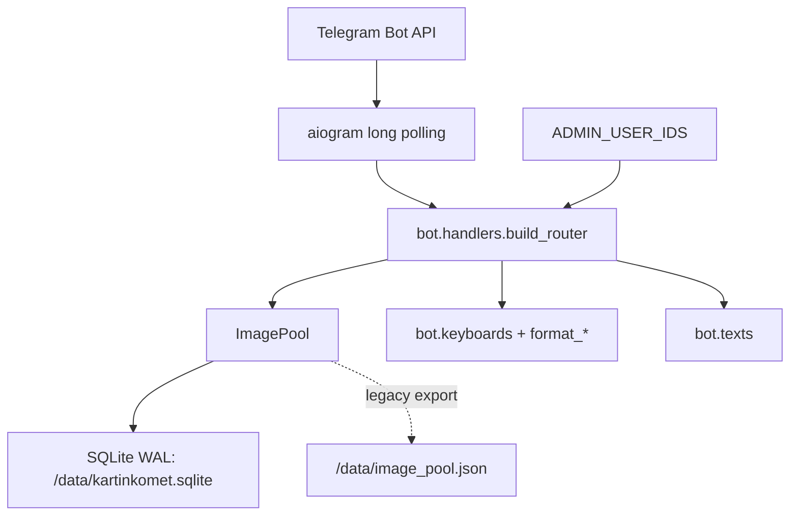
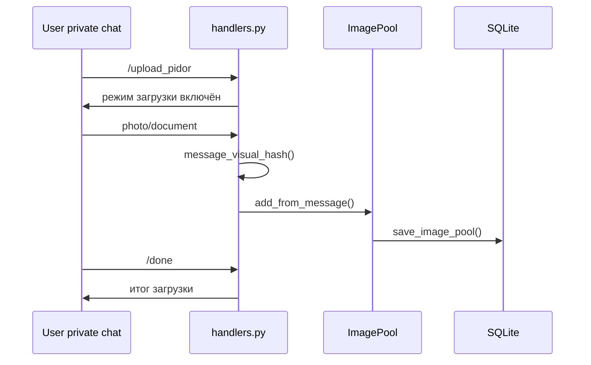

# Архитектура kartinkomet-bot

Этот файл — короткая карта проекта. Его цель: быстро вспомнить, где что лежит, как течёт логика и какие правила нельзя ломать, не перечитывая всю кодовую базу.

## 1. Что делает бот

`kartinkomet-bot` — Telegram-бот для общего склада пикч.

Основные сценарии:

- выдаёт случайную пикчу по `/pic` и кнопке `🎲 Рандом`;
- принимает новые пикчи в личке через `/upload_pidor`;
- хранит только Telegram `file_id` и `file_unique_id`, сами картинки остаются у Telegram;
- защищается от точных и визуальных дублей;
- даёт реакции `🤙🏻` и `🖕🏻`;
- удаляет пикчу из пула после `2 🖕🏻`;
- запускает дуэли двух пикч и турниры четырёх пикч;
- показывает склад, статистику, топ загрузчиков и личный вклад пользователя;
- имеет скрытые админские команды для health, backup, reset и dedupe.

## 2. Production-схема



В проде бот живёт на Railway:

- процесс: `python -m bot`;
- тип запуска: long polling;
- реплик: `1`;
- volume mount: `/data`;
- основная база: `/data/kartinkomet.sqlite`;
- JSON-файл: `/data/image_pool.json` как legacy-страховка и совместимость.

Источник истины в production — SQLite. JSON нельзя считать главным live-хранилищем: он оставлен для совместимости, fallback-сценариев и старых maintenance-утилит. Для переноса и бэкапа ориентироваться нужно на `kartinkomet.sqlite` и команду `/backup`.

Важно: long polling нельзя запускать в нескольких репликах. Telegram начнёт отдавать `Conflict: terminated by other getUpdates request`.

## 3. Структура проекта

```text
bot/
  __main__.py      # входная точка, команды Telegram, Dispatcher, Router
  config.py        # чтение env-переменных
  handlers.py      # команды, callbacks, FSM загрузки, UI-тексты, арены
  image_pool.py    # бизнес-логика пула: add, random, reactions, stats, dedupe
  keyboards.py     # inline-клавиатуры и callback_data
  storage.py       # SQLiteDocumentStore, схема БД, WAL, backup
  texts.py         # большие наборы фраз и текстовые константы
  visual_hash.py   # perceptual hash для визуального антидубля

scripts/
  visual_dedupe.py # CLI-скрипт для массовой визуальной чистки дублей

tests/
  test_contract.py # контрактные тесты команд, UI, хранилища и ключевой логики

data/
  image_pool.json  # локальный dev fallback, не production-источник
```

## 4. Точка входа

Файл: `bot/__main__.py`

Что делает:

1. читает конфиг через `load_config()`;
2. создаёт `Bot`;
3. создаёт `Dispatcher` с `FSMStrategy.CHAT`;
4. подключает `build_router(...)`;
5. выставляет публичные Telegram-команды через `set_my_commands`;
6. запускает `dispatcher.start_polling(bot)`;
7. закрывает session в `finally`.

Публичные команды задаются в `BOT_COMMANDS`. Если меняешь меню команд в Telegram, сначала смотри сюда.

## 5. Конфигурация

Файл: `bot/config.py`

Обязательная переменная:

```env
BOT_TOKEN=...
```

Основные переменные Railway:

```env
RAILWAY_VOLUME_MOUNT_PATH=/data
ADMIN_USER_IDS=177117495
```

Опционально:

```env
DATABASE_PATH=/data/kartinkomet.sqlite
IMAGE_POOL_PATH=/data/image_pool.json
TARGET_CHANNEL_ID=
```

Если `DATABASE_PATH` не задан, путь собирается из `RAILWAY_VOLUME_MOUNT_PATH`.

## 6. Хранилище

Главная обёртка: `ImagePool` в `bot/image_pool.py`.

Физическое хранение: `SQLiteDocumentStore` в `bot/storage.py`.

Основные таблицы:

| Таблица | Назначение |
| --- | --- |
| `images` | пикчи, `file_id`, `file_unique_id`, счётчики, `visual_hash` |
| `users` | Telegram user metadata для топа и профиля |
| `image_reactions` | один голос пользователя на одну пикчу |
| `image_chat_history` | память недавних выдач по чатам |
| `image_stats` | агрегаты дуэлей, турниров и storage version |
| `documents` | legacy JSON-document slot |

SQLite настройки:

- `journal_mode=WAL`;
- `synchronous=NORMAL`;
- `foreign_keys=ON`;
- `busy_timeout=30000`;
- `PRAGMA optimize` при инициализации.

## 7. ImagePool: основные методы

Файл: `bot/image_pool.py`

| Метод | Что делает |
| --- | --- |
| `add_from_message(...)` | извлекает фото/document, проверяет лимит, точные и визуальные дубли, добавляет запись |
| `random_image(...)` | выбирает случайную пикчу с анти-повторами и весами |
| `random_duel_pair(...)` | выбирает две пикчи для дуэли |
| `random_tournament_candidates(...)` | выбирает четыре пикчи для турнира |
| `react(...)` | ставит или перевыбирает реакцию пользователя |
| `delete(...)` | удаляет пикчу из пула и истории |
| `finish_duel(...)` | удаляет проигравшую пикчу и пишет статистику дуэли |
| `record_tournament_result(...)` | пишет статистику турнира |
| `reset_stats(...)` | сбрасывает реакции, показы и память рандома, не удаляя пикчи |
| `dedupe_user(...)` | удаляет точные дубли конкретного пользователя |
| `top_uploaders(...)` | считает топ загрузчиков |
| `reaction_stats_by_user(...)` | статистика реакций на пикчи пользователя |
| `health(...)` | состояние backend, путей, счётчиков и visual hash |

## 8. Алгоритм рандома

Цель: не крутить одну и ту же пикчу слишком часто.

Логика:

1. Если пул пустой — вернуть `None`.
2. Собрать кандидатов через `_selectable_records(...)`.
3. Убрать недавние выдачи текущего чата.
4. Учитывать глобальную историю последних показов.
5. Оставить окно наименее показанных кандидатов.
6. Выбрать взвешенным рандомом.
7. Записать показ в `shown_count`, `last_shown_at` и `image_chat_history`.

Веса:

- меньше показов — больше шанс;
- свежие пикчи получают небольшой бонус;
- пикчи с большим количеством `🖕🏻` получают штраф;
- `SystemRandom` используется вместо обычного `random`.

Константы:

```python
RANDOM_CANDIDATE_LIMIT = 120
GLOBAL_RECENT_LIMIT = 250
MAX_CHAT_HISTORY = 500
```

## 9. Загрузка пикч

Команда: `/upload_pidor`

FSM state: `AddPicture.waiting_for_image` в `bot/handlers.py`.

Поток:



Правила:

- загрузка работает стабильно в личке;
- в группе бот объясняет, что пикчи надо кидать в личку;
- лимит: `1000` пикч в час на пользователя;
- burst-limit: `120` сообщений в минуту в активной загрузке;
- точные дубли пропускаются;
- визуальные дубли пропускаются через perceptual hash;
- невалидные файлы идут в счётчик ошибок.

## 10. Реакции

Файл логики: `ImagePool.react(...)`.

Кнопки: `bot/keyboards.py`, функции `picture_actions` и `picture_actions_with_counts`.

Правила:

- реакции только `like` и `dislike`;
- UI показывает `🤙🏻` и `🖕🏻`;
- один пользователь может иметь только один голос на одну пикчу;
- пользователь может перевыбрать голос;
- повторный тап по тому же голосу не накручивает счётчик;
- после `2 🖕🏻` пикча удаляется из пула.

## 11. Дуэли

Команда: `/duel`

Ключевые функции:

- `send_duel(...)`;
- `update_duel_score_message(...)`;
- `finalize_duel(...)`;
- `resolve_image_duel_result(...)`;
- `register_active_duel(...)`;
- `clear_active_duel(...)`.

Поток:

1. Проверить, что в чате нет активной дуэли пикч.
2. Выбрать пару через `ImagePool.random_duel_pair(...)`.
3. Отправить альбом из двух пикч.
4. Отправить score-message с кнопками.
5. При каждом голосе обновлять счёт.
6. Через 60 секунд закрыть дуэль.
7. Если есть победитель — удалить проигравшую пикчу.
8. Если ничья — оставить обе.
9. Показать кнопки реванша, рандома, турнира и пульта.

Активные дуэли живут в памяти процесса:

```python
duel_sessions
active_duels_by_chat
```

После рестарта Railway активные дуэли не восстанавливаются. Это нормально: долгоживущие данные лежат в SQLite, временные арены — в RAM.

## 12. Турниры

Команда: `/tournament`

Ключевые функции:

- `send_tournament(...)`;
- `update_tournament_score_message(...)`;
- `finalize_tournament(...)`;
- `resolve_tournament_result(...)`;
- `register_active_tournament(...)`;
- `clear_active_tournament(...)`.

Поток:

1. Проверить, что в чате нет активного турнира.
2. Выбрать четыре пикчи.
3. Отправить альбом.
4. Отправить score-message.
5. Голосование длится 90 секунд.
6. Победитель показывается в финале.
7. Никто не удаляется.

Активные турниры живут в памяти процесса:

```python
tournament_sessions
active_tournaments_by_chat
```

## 13. UI-слой

Кнопки:

- `bot/keyboards.py`.

Тексты сообщений:

- большинство `format_*` функций в `bot/handlers.py`;
- большие наборы фраз в `bot/texts.py`.

Главные UI-принципы проекта:

- команды в группе не должны шуметь лишними подсказками;
- загрузка идёт в личке, чтобы Telegram Privacy Mode не ломал приём фото;
- главный пульт запускает рандом, дуэль, турнир, склад, сводку и загрузку без лишнего промежуточного экрана;
- карточки должны быть короткими и структурными;
- активные арены показывают таймер и счёт;
- кнопки не должны плодить дублирующие действия;
- кнопки размечаются семантическими стилями: `primary`, `success`, `danger`;
- удалённые функции не должны оставаться в меню, README и тестах как активные возможности.

Семантические стили живут в `styled_button(...)`:

| Стиль | Когда использовать |
| --- | --- |
| `primary` | основная навигация, рандом, дуэль, турнир, склад |
| `success` | загрузка, завершение, бэкап, реванш |
| `danger` | отмена, сброс, негативный голос |

Если конкретный Telegram-клиент не поддерживает цветные inline-кнопки, он показывает обычную кнопку. Логика callback-ов от этого не меняется.

Основные клавиатуры:

| Функция | Где используется |
| --- | --- |
| `main_menu(...)` | главный пульт с прямым запуском рандома, дуэли, турнира, склада, сводки и загрузки |
| `random_menu()` | раздел рандома |
| `arena_menu(...)` | подробный экран дуэлей и турниров, совместимый со старыми callback-кнопками |
| `storage_menu(...)` | склад, топ, профиль, загрузка |
| `upload_hub(...)` | вход в загрузку |
| `upload_menu()` | завершить/отменить загрузку |
| `duel_vote(...)` | голосование в дуэли |
| `tournament_vote(...)` | голосование в турнире |
| `picture_actions_with_counts(...)` | реакции под пикчей |
| `admin_menu()` | скрытая админка |

## 14. Админские команды

Админ определяется через `ADMIN_USER_IDS`.

Публичное Telegram-меню их не показывает.

| Команда | Назначение |
| --- | --- |
| `/admin` | скрытая админ-панель |
| `/health` | состояние backend, счётчиков, путей |
| `/backup` | отправить SQLite backup и JSON export |
| `/reset_stats` | сбросить показы, реакции и память рандома |
| `/dedupe_user <id>` | удалить точные дубли пользователя |
| `/id` | показать Telegram user ID |

## 15. Бэкап и перенос

Критичные файлы на Railway Volume:

```text
/data/kartinkomet.sqlite
/data/kartinkomet.sqlite-wal
/data/kartinkomet.sqlite-shm
/data/image_pool.json
```

Для живого backup лучше использовать `/backup` в личке админу. Он вызывает SQLite backup API, а не просто копирует файл на горячую.

Если переносишь сервис:

1. остановить старый bot process или убедиться, что не будет двух polling-инстансов;
2. забрать `kartinkomet.sqlite` через `/backup`;
3. перенести файл на новый persistent storage;
4. выставить `DATABASE_PATH`;
5. запустить одну реплику;
6. проверить `/health`, `/count`, `/pic`.

## 16. Скрипт визуальной чистки

Файл: `scripts/visual_dedupe.py`

Dry-run:

```bash
python scripts/visual_dedupe.py --user-id 1045485205 --dry-run --threshold 3
```

Реальная чистка:

```bash
python scripts/visual_dedupe.py --user-id 1045485205 --threshold 3
```

Скрипт:

- читает текущий пул;
- считает визуальные хэши;
- ищет близкие изображения по Hamming distance;
- делает backup перед изменением;
- чистит историю чатов от удалённых id.

## 17. Тесты

Основной файл: `tests/test_contract.py`.

Что проверяется:

- список публичных команд;
- отсутствие удалённых фич;
- schema SQLite;
- миграция `visual_hash`;
- добавление пикч;
- точные и визуальные дубли;
- реакции и перевыбор;
- удаление по `2 🖕🏻`;
- анти-повтор рандома;
- fallback рандома при пустом окне кандидатов;
- дуэль и удаление проигравшей;
- турнирная логика;
- клавиатуры;
- тексты без старых артефактов;
- README не светит скрытые команды в публичном блоке.

Команды проверки:

```bash
.venv/bin/python -m compileall bot scripts tests
.venv/bin/python -m unittest
git diff --check
```

## 18. Что трогать при типовых задачах

| Задача | Файлы |
| --- | --- |
| Добавить команду | `bot/__main__.py`, `bot/handlers.py`, тесты |
| Изменить кнопку | `bot/keyboards.py`, иногда `bot/handlers.py` |
| Изменить текст карточки | `bot/handlers.py` |
| Добавить пачку фраз | `bot/texts.py` |
| Поменять рандом | `bot/image_pool.py`, тесты |
| Поменять лимиты загрузки | `bot/image_pool.py`, `bot/handlers.py`, README |
| Поменять схему БД | `bot/storage.py`, миграция, тесты |
| Поменять деплой | `Procfile`, `.python-version`, README |
| Удалить фичу | код, команды, клавиатуры, README, тесты на отсутствие |

## 19. Инварианты, которые нельзя ломать

- Бот не хранит физические картинки, только Telegram identifiers.
- В production должна быть одна polling-реплика.
- `/data` должен быть persistent Volume.
- `file_unique_id` должен оставаться главным ключом точного антидубля.
- Один пользователь — один голос на одну пикчу, но голос можно перевыбрать.
- `2 🖕🏻` удаляют пикчу.
- Дуэль удаляет проигравшую, турнир никого не удаляет.
- Загрузка в группе не должна пытаться принимать фото как основной сценарий.
- Админские команды не должны попадать в публичное Telegram-меню.
- Любой новый UI-экран должен иметь понятный путь назад в пульт.

## 20. Быстрая диагностика

Если бот не отвечает:

1. Railway service должен быть `Online`;
2. в логах должно быть `Start polling`;
3. не должно быть `TelegramConflictError`;
4. проверить `BOT_TOKEN`;
5. проверить, что реплика одна;
6. проверить `/health` в личке админу.

Если не сохраняются пикчи:

1. загрузка должна идти в личке;
2. проверить `/health`;
3. проверить `/data` volume;
4. проверить лимиты загрузки;
5. проверить, не дубли ли это;
6. проверить `visual_hashes` и `/backup`.

Если часто повторяется рандом:

1. проверить размер пула `/count`;
2. проверить `/reset_stats` только если реально надо обнулить память;
3. смотреть `RANDOM_CANDIDATE_LIMIT`, `GLOBAL_RECENT_LIMIT`, `MAX_CHAT_HISTORY`;
4. убедиться, что пул не состоит из визуальных дублей.

Если зависла арена:

1. нажать пульт и проверить активные арены;
2. дождаться таймера;
3. если был рестарт Railway — старая арена могла остаться только в Telegram-сообщении, в памяти процесса её уже нет;
4. новая команда должна создать новую арену, если RAM-сессия очищена.
