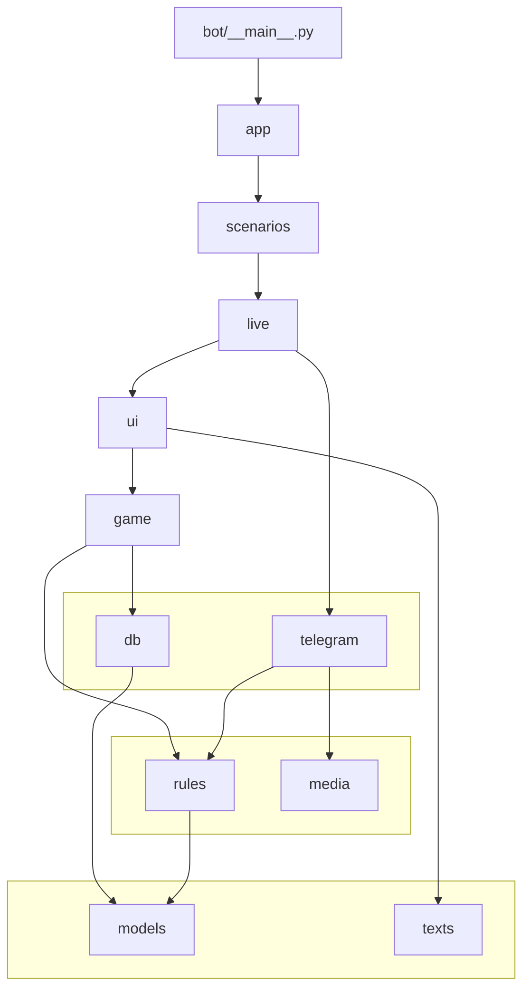

# Архитектура kartinkomet

## Структура

Код разложен по разделам, и каждый раздел импортирует только из тех, что ниже него. Порядок задан в
[.importlinter](../.importlinter), CI проверяет его командой `lint-imports`. Там же второй контракт:
игра и всё, что под ней, не знают про aiogram и `bot.telegram`. Схему и таблицу ниже строит из
настоящих импортов `python scripts/layers.py`; тест `tests/structure` падает, если они устарели.
Стрелка означает «опирается на»; стрелки, которые следуют из более длинного пути, на схеме опущены.

<!-- layers:begin: scripts/layers.py writes this block from .importlinter and the imports -->



| Раздел | Опирается на (сколько импортов) |
|---|---|
| `bot/__main__.py` | `app` (1), `telegram` (1) |
| `app` | `scenarios` (2), `live` (1), `game` (2), `db` (1) |
| `scenarios` | `live` (18), `ui` (23), `game` (23), `telegram` (21), `rules` (13), `media` (2), `models` (1), `texts` (34) |
| `live` | `ui` (1), `game` (2), `telegram` (1), `rules` (3), `texts` (1) |
| `ui` | `game` (6), `rules` (23), `models` (8), `texts` (39) |
| `game` | `db` (1), `rules` (17), `models` (9) |
| `db` | `models` (7) |
| `telegram` | `rules` (1), `media` (1) |
| `rules` | `models` (2) |
| `media` | — |
| `models` | — |
| `texts` | — |

<!-- layers:end -->

Сценарии стоят на одном уровне, потому что по делу вызывают друг друга. Ответ на сообщение бота
(`replies`) продолжает тот сценарий, чьё это сообщение: суд, подпись, титул, выбор человека. Реакции
(`pics`) открывают суд и роняют золотую пикчу. Лавка, казино и админка возвращают в пульт, а пульт
запускает «Больше/Меньше». Принятый вызов (`challenges`) — это бой арены. Расписание (`schedule`)
зовёт того же босса и тот же суд, что и команды.

| Раздел | Что внутри | Куда класть новое |
| --- | --- | --- |
| `models/` | Записи `Pic`, `Battle`, `Court`, `UserStats` | Новую запись, которую читают правила, игра и оформление |
| `texts/` | Фразы и `pick()` с анти-повтором | Фразы новой механики — своим модулем |
| `rules/` | Чистые правила: Elo, исход боя, вердикт суда, казино, квесты, босс, сезоны, цены | Формулы, шансы и цены — всё, что считается без базы, Telegram и часов |
| `media/` | Pillow: коллаж боёв, визуальный хэш дублей | Работу с картинками |
| `telegram/` | Ленивая загрузка aiogram (`lean.py`), отправка с ретраями и личными сообщениями (`send.py`), скачивание пикч и сборка коллажа (`pictures.py`) | Новые виды вызовов Telegram API |
| `db/` | `schema.sql`, миграции (`schema.apply_schema`), SQL по миксину на домен, `Repo` (`repo.py`) | Таблицы и колонки — с миграцией; запросы — в миксин своего домена |
| `game/` | `engine.Game`: часы, `pay()`, `reward()`; миксин на механику; результаты в `types.py` | Логику механики — миксином, подключённым к `Game` |
| `ui/` | Дизайн-система (`layout.py`), тексты карточек (`cards/`, собраны в `views.py`), кнопки (`keyboards.py`), экраны пульта (`screens.py`) | Карточку — в `cards/<механика>.py` и строку в `views.py`; кнопки — в `keyboards.py` |
| `live/` | Живые карточки `timers.Live`: перерисовка с ограничителем, отсчёты, итоги боёв, судов и игр | Новый вид живой карточки |
| `scenarios/` | Роутер на механику; `replies.py` — все ответы на сообщения бота; `targets.py` — «кого и сколько»; `schedule.py` — расписание | Команду или кнопку — роутером своей механики, подключённым в `app/main.build_dispatcher`; событие по часам — в `schedule.JOBS` |
| `app/` | Настройки (`config.py`), команды меню, сборка диспетчера и запуск (`main.py`), `middleware.py`, сторож polling (`watchdog.py`) | То, что касается процесса целиком |
| `bot/__main__.py` | `python -m bot`: ленивый aiogram, затем `app.main` | — |

```
tests/
  harness.py     фейковый Telegram и BotHarness — основа сценариев
  helpers.py     make_game, GameCase — основа тестов игры
  layout.py      дизайн-система как проверки, их проходит каждое сообщение
  rules/ game/ scenarios/ ui/ runtime/ structure/
scripts/         dump_screens.py (все сообщения пузырями), load_test.py (нагрузка), layers.py (схема слоёв)
```

Поток: `Telegram → scenarios → game.engine.Game (game → rules, db) → ui → telegram.send → Telegram`.
Живые карточки (`live`) по таймеру перерисовываются и подводят итоги.

**Дизайн-система** (`ui/layout.card`, проверяется тестами на каждом сообщении — `tests/layout.layout_problems`): заголовок обычным регистром, жирный, с эмодзи («⚔️ <b>Дуэль</b> · 0:45»), под ним строка-шутка курсивом; короткие ответы и отказы тоже начинаются с эмодзи своей механики (`views.marked`, у людей — эмодзи действия), подпись самой пикчи — курсивом; каждый блок открывается своим эмодзи или знаком списка (1., ▫️, 🟥), в списке нет строк без знака, у одиночного пункта могут быть строки-описания; правила, подсказки и пояснения — в рамке-цитате в конце карточки (`views.note`), там текст переносится свободно; один эмодзи в строке и только в её начале; вне рамки строка длиннее строки телефона (32 символа, `layout.PHONE_LINE`, заглавные на четверть шире — замерено на Telegram iOS) стоит отдельно или завершает свой блок; заголовок не переносится — если «Заголовок · подробность» не влезает, `card()` уносит подробность на вторую строку; имена — в своём регистре, деньги — стрелкой «от кого → кому». `tests/ui/test_screens.py` проходит по всем экранам с заполненными данными, а живые и итоговые карточки — во всех состояниях. `python scripts/dump_screens.py screens.html` выгружает по одному образцу каждого сообщения пузырями шириной с телефон.

Зависимости в обработчики приходят через workflow data диспетчера: `game`, `live`, `admins`.

## Данные

Схема — [bot/db/schema.sql](../bot/db/schema.sql). Время везде в unix-секундах UTC.

- **pics**: пикча никогда не удаляется физически. `status` = `alive` / `executed` / `deleted`, плюс `removed_reason` (`duel`, `court`, `admin`). Здесь же рейтинг, бои, победы, поражения, `loss_streak`, `best_streak`, иммунитет.
- **deck_seen**: какие пикчи уже показаны в текущем круге колоды. Скоупы: `pic:<chat>` для рандома, `arena:<chat>` для боёв.
- **battles / battle_entries / battle_votes**: дуэли и турниры, включая активные. Таймеры переживают рестарт.
- **courts / court_votes**: суды, последнее слово, сообщение с пикчей, на которой висят кнопки.
- **achievements**, **meta** (рекорды серий, счётчики, отметки миграции), **panels** (живая панель на чат).

## Ключевые потоки

**Рандом.** `deck.draw_one` бросает кубик 70/20/10, берёт случайную живую пикчу, не показанную в этом скоупе, и отмечает её показанной. Если показаны все, `deck_seen` скоупа очищается: начинается новый круг.

**Реакция → суд.** `Game.react` пишет реакцию. Если дизлайков стало ровно 2 (или 4, 6…), нет иммунитета и нет активного суда, то `court_due=True`. Тогда `scenarios/court.open_court` создаёт суд, отправляет карточку-фото ответом на пикчу и меняет кнопки пикчи на «⚖️ Идёт суд».

**Бой.** `Game.start_duel` создаёт запись боя ещё до отправки альбома. Поэтому второй клик в ту же секунду увидит активный бой и не запустит второй. Если Telegram не принял альбом, бой удаляется. `Live` раз в 15 секунд обновляет карточку, а по таймеру вызывает `Game.finish_battle`. Закрытие атомарное (`UPDATE … WHERE status='active'`), так что двойного финала не бывает.

**Коллаж арены.** `bot/media/collage.py` склеивает пикчи (дуэль 1×2, турнир 2×2) и рисует на каждой цветную метку — того же цвета, что полоска голосов. Карточка голосования — подпись к этому фото, итог правит ту же подпись (`battles.card_is_photo`). Таймер боя перезапускается после отправки, чтобы скачивание не съедало время голосования. Если коллаж не собрался (не скачалось, битый файл), бот отправляет обычный альбом и текстовую карточку.

**Чемпион.** Кнопка «👑 Чемпион дальше» несёт id боя. Она работает, только если этот бой — последняя дуэль чата (`meta last_duel:<chat>`). Старые кнопки отвечают «уже не актуально».

**Голоса.** Голос пишется сразу, а карточка перерисовывается не чаще раза в 1.5 секунды (`Live.request_refresh_*`): Telegram ограничивает частоту правок в чате.

**Самовосстановление.** Если таймер боя или суда умер, а запись осталась активной, следующий запуск дуэли или суда сначала досчитает зависший и только потом начнёт новый.

**Кнопки v1.** Реакции `react:like|dislike:<id>` под старыми сообщениями переводятся в v2: id пикч при миграции сохранены. Остальные старые кнопки отвечают «жми /menu».

**Память.** aiogram при импорте строит pydantic-валидаторы для всех типов Telegram — на 3.31 это около 235 МБ, хотя боту нужны десятки. `bot/telegram/lean.py` (вызывается из `bot/__main__.py`) перехватывает этот разовый `model_rebuild`, запоминает пространство имён и оставляет модели отложенными: pydantic соберёт каждую при первом настоящем апдейте. Итог — около 70 МБ. Приём опирается на внутренности pydantic, поэтому версия закреплена в `requirements.txt`; тесты идут в том же режиме (`tests/__init__.py`), а `tests/runtime/test_lean.py` разбирает сообщения с редким содержимым. Ответы Telegram aiogram разбирает через `Response[тип]` — модель, которую pydantic создаёт на лету, — поэтому пространство имён получает и `Response`. Это ловит тест в отдельном процессе: внутри общего прогона модели уже собраны другими тестами, и поломка не видна. Фейковый Telegram в тестах тоже отдаёт ответы JSON-ом через настоящий `check_response`.

**Сторож опроса.** `bot/app/watchdog.py` сидит в сессии бота и отмечает каждый разобранный ответ на `getUpdates`. Если их не было 10 минут, он пишет админам (если ещё может) и останавливает процесс с ошибкой: Railway перезапускает его и показывает падение, а не «Online» у бота, который ничего не слышит. Перерисовка живой карточки, упавшая на баге, не останавливает обратный отсчёт: бой или суд всё равно подводится.

**После простоя.** Telegram копит все команды и нажатия, пока бот лежит. Если самой старой записи в очереди больше 10 минут, бот при запуске сбрасывает очередь (`drop_stale_backlog`), а не отвечает разом на часы старых команд. Очередь обычного деплоя обрабатывается как есть. Босс, чья карточка не дошла до чата, при рестарте удаляется: сразиться с ним никто не мог.

**Возможности Bot API.** Ленивая загрузка позволяет держать свежий aiogram (3.31) без лишней памяти, поэтому всё штатное: эфемерный профиль в группе (`sendMessage` с `EphemeralMessageParameters`) с откатом на обычную панель, если Telegram отказал; цветные кнопки (`style`); реакции бота (`setMessageReaction`); раскрывающиеся цитаты; эффект 🎉 в личке. Имена пишутся без `@` (упоминание пингует человека) и в своём регистре: заголовок может быть капсом, имя — никогда. Монеты в карточках — «🪙 +N» и «🪙 −N».

**Личное — лично.** Что касается одного человека, в группе видит только он (`send.personal`, `send.reply_personal`): отказы команд («уже идёт», «рано», «не хватает монет»), бонус дня, деревянные и редкие сундуки, отказы колеса и гороскопа с кнопок. Отказы на кнопках — всплывашки. В чат идут события, которые интересны всем: бои, суды, боссы, легендарный сундук. Последнее слово в суде подтверждается реакцией ✍, а не ответом; ответка босса — строка «😤» в живой карточке босса (и всплывашка, если досталось тому, кто бил), а не сообщение в чат. Если Telegram отказал в эфемерном сообщении, оно уходит в чат как обычно, а подсказки и отказы через минуту удаляются сами (`send.fleeting`). Правило Telegram: бот без прав админа может писать лично только в ответ на нажатие кнопки (`callback_query_id`) или на эфемерное сообщение, в течение 15 секунд; админ — кому угодно и когда угодно. Чат, где эфемерное сообщение без такого повода не прошло, полчаса не пробуется зря; повышение бота до админа (`my_chat_member`) снимает паузу.

**Коллажи** (`bot/media/collage.py`): каждая пикча — карточка одного размера со скруглёнными углами: сверху цветная плашка с буквой или номером (цвета те же, что у строк голосов и кнопок), под ней пикча целиком с отступом, рамка эволюции или сундука — вокруг карточки. Скачанные пикчи кэшируются в памяти (`arena._downloads`, до 40 МБ), коллаж собирается за ~50 мс.

**Живые карточки и лимиты Telegram.** Группе можно около 20 сообщений в минуту, правки тоже считаются. Все живые карточки чата вместе перерисовываются не чаще раза в `timers.LIVE_EDIT_GAP` (3,5 с), карточка рисуется уже после ожидания (видно свежее состояние), одинаковая не отправляется (`send.live_edit`), а flood wait на перерисовке не усыпляет бота — только откладывает следующие перерисовки этого чата. Фразы живых карточек стабильны (`pick.steady`): меняются с голосами, а не на каждом тике. `python scripts/load_test.py` гоняет сотни одновременных нажатий с задержкой сети и сверяет счёт.

**Пульт у каждого свой.** В группе общий пульт (одно сообщение на чат, `panels`) всегда стоит на главной. Раздел, нажатый на нём, открывается нажавшему лично — эфемерно, на месте пульта (`replace_callback_query_message`), а если Telegram так не может, то под ним; дальше нажатия перерисовывают эту личную копию (`editEphemeralMessageText`, `send.redraw`). Так чужое «Слоты» не уносит у тебя лавку посреди покупки. Исчезнувшая копия (Telegram стирает их при перезапуске приложения) заменяется новой; «🔄 Обновить» на главной перерисовывает сам общий пульт. `/shop`, `/casino`, `/me`, `/quests` в группе тоже приходят лично. На личном экране казино смена ставки сразу переносит ✅; на общем пульте — только всплывашка, чтобы не показывать чужую ставку всем.

**Великий передел** (`Game.redistribute`, задача `redistribution` в 18:00 по местному времени): раз в день весь баланс одного игрока — случайного среди тех, у кого есть монеты и кто что-то заработал за 14 дней, админы тоже; в первый день, `FIRST_REDISTRIBUTION`, — выбранного админом — расходится остальным активным в долях `expovariate`, остаток округления — самому везучему. Раздают не больше `REDISTRIBUTION_CAP_WALLETS` (10) базовых кошельков по 2000, умноженных на множитель наград; остальное сгорает, и карточка это показывает. Потолок не следует за медианой: иначе бездонный кошелёк кормил бы медиану, от которой считается его же потолок. Итог дня, вместе со сгоревшим, лежит в `meta redistribution:<день>`: кошелёк берут один раз, а все чаты объявляют одно и то же. Выплаты не считаются заработком (`earn = 0`).

**Кого и сколько.** `/rob`, `/give`, `/marry`, `/pvp`, `/challenge` живут на `scenarios/targets.py`: цель — ответ на сообщение, упоминание (`text_mention` даёт человека и без ника), ник или имя среди игроков чата (`chat_members`, пишется middleware). Если команда без цели или суммы (так её шлёт меню команд), бот спрашивает кнопками: последние игроки чата или суммы; ответ на вопрос ником или числом тоже работает. Вопрос лежит в `meta ask:<chat>:<user>` пять минут, кнопки `ak:<chat>:<user>:<n>` жмёт только автор; после ответа вопрос удаляется, и команда выполняется тем же кодом, что и с полной строкой. Модули команд регистрируют `RUNNERS` (сделать), `PREPARE` (начальное состояние для кнопок пульта и `/divorce`), `CHECKS` (почему автор не может прямо сейчас: обезьянник, нет денег на кольцо — до любого вопроса) и `FILTERS` (кого стоит предлагать: грабить можно не нищих и не супругов, жениться — на свободных). Админов (`ADMIN_USER_IDS`) ограбить нельзя: попытка всегда проваливается, грабитель отдаёт админу ту сумму, которую унёс бы при удаче, и садится в обезьянник как обычно; карточка — обычный провал со своими фразами (`ROB_GUARDED`, единственный пул с плейсхолдером `{victim}`). У вызовов и «1 на 1» есть вариант «🌍 Любой»; у развода — подтверждение. Раздел пульта «👥 Люди» (`pp:<действие>`) запускает то же самое кнопкой, а нажатие кнопки даёт право ответить лично даже боту без прав админа.

**Расписание.** `scenarios/schedule.py` просыпается раз в минуту и работает в местном времени чата (`BOT_TZ_OFFSET`). Задачи: бэкап админам (04:00), пикча дня (12:00, самая залайканная за сутки или легенда), босс (16:00, по субботам рейд), суд над худшей со дна (19:00), итоги недели (воскресенье 18:00), предупреждение о конце сезона (12:00 последнего дня месяца). Каждая отмечается в `meta` ключом `event:<задача>:<чат>:<день|неделя>` до выполнения — рестарт не повторит и не пропустит её, а упавшая задача не будет долбить каждую минуту. Задача срабатывает только в течение 3 часов после своего времени. Чаты берутся из таблицы `chats` (middleware отмечает группы не чаще раза в 10 минут; при старте она дополняется чатами из истории боёв), выключаются в админке.

**Защита от спама.** Между выдачами пикч в одном чате минимум 1.5 секунды: Telegram пускает в группу около 20 сообщений в минуту и при превышении глушит бота во всём чате.

**Овертайм.** Если к концу боя нет ни одного голоса, бой один раз продлевается на 30 секунд (`battles.extended`).

**Экономика.** `rules/economy.py` — суммы и уровни. Коины пишутся в `players` и в журнал `ledger` (из него считаются короны недели). Голосующим платят при подведении итога боя, а не при нажатии — переголосовывание не фармит. За лайк платят только за первый лайк человека на пикчу.

**Ачивки.** `rules/achievements.py`: правила по статистике и счётчикам (`counters`) плюс ситуативные коды, которые игра выдаёт в момент события. Голоса не объявляют ачивки сами — они копятся в `Game._pending_events` и уходят со следующим объявлением. Все ачивки и повышения уровня одного события — одно сообщение. При добавлении новых правил меняется `Game.BACKFILL_KEY`, и уже заработанное выдаётся молча.

**Мини-игры.** «Подпиши пикчу» — таблицы `games`, `game_entries`, `game_votes`; фазы collect → vote → done двигает `Live`, ответы на сообщение конкурса ловит общий обработчик ответов боту (суд или конкурс). Золотая пикча — `gold`, забирает первый атомарным `UPDATE … WHERE claimed_by IS NULL`. Колесо — Telegram 🎰 (`sendDice`): значение 1–64 раскладывается на три барабана, 64 = 777.

**Рестарт.** `Live.restore()` поднимает таймеры всех активных боёв, судов и конкурсов. Просроченные финализируются сразу.

## v4: монеты и люди

**Деньги.** `Repo.add_coins(…, earn=)`: доход от активности (голоса, лайки, квесты, боссы) растит уровень и корону «богач»; казино, ставки, подарки, грабежи и стартовые 1111 — нет (`ledger.earn = 0`). Списания идут через `Repo.spend` — атомарный `UPDATE … WHERE coins >= ?`, два быстрых нажатия не уведут баланс в минус.

**Казино.** `rules/casino.py`: таблицы выплат для каждого кубика Telegram (`sendDice` с 🎰 🎲 🎯 🏀 ⚽ 🎳). Ставка списывается до броска, выплата — после анимации. У всех игр, кроме «кости против бота», есть небольшое преимущество казино (EV ≈ 0.9–0.97).

**Ставки на арене.** `battle_bets`, тотализатор: победители делят весь банк пропорционально ставкам, ничья — возврат, на победителя никто не ставил — банк сгорает.

**Вызовы.** Бой игрок против игрока — обычная дуэль с `battles.mode = 'challenge'`: без смертей и серий, участники не голосуют и не ставят, обычные дуэли параллельно не блокируются. Ставки держатся в `challenges` до итога или истечения (возврат).

**Апелляция.** После казни судом загрузчик 5 минут может внести залог: пикча оживает, открывается суд с `courts.appeal = 1`, где для казни нужно 3 голоса. Помилование — залог назад, казнь — окончательно.

**Лавка.** Меню 🛒 под пикчей приходит эфемерно; кнопки несут короткий токен, а пикча, покупатель и чат лежат в `meta pm:<token>` — так callback не упирается в 64 байта и работает, даже если эфемерный callback придёт без сообщения.

**Прогресс.** Квесты дня зависят от `(user, день)`, челленджи недели — общие для всех. Прогресс считает `Game.progress(user, kind)`, счётчики `q:<день>:<kind>` и `w:<неделя>:<kind>` в `counters` чистятся при смене дня. Выполненные квесты и сундуки копятся в `_pending_notes` и уходят в общее объявление с кнопками «открыть сундук».

**Событие дня.** `rules/days.py`: в 10:00 бросается одно из 18 событий (не то же, что вчера), хранится в `meta day_event:<день>` и меняет правила через `Game.day_is(...)` до полуночи.

**Боссы.** `bosses` + `boss_hits`, таймер в `Live` как у боёв. Удар обновляет карточку с дебаунсом, убийство финализирует сразу.

## v5: сезоны, цены и новые игры

**Сезоны.** `rules/seasons.py` — календарный месяц в местном времени. Очки сезона — сумма `ledger.amount > 0 AND earn = 1` за месяц (голоса, лайки, загрузки, квесты, боссы, бонус дня), так что казино и подарки не помогают. `Game.roll_season()` вызывается на каждом тике расписания, а не как задача по часам: если в полночь первого числа бот лежал, сезон закроется при первом же запуске. Первый вызов только запоминает текущий сезон в `meta season`; при смене месяца тройка сохраняется в `seasons`, а `Repo.reset_coins` ставит всем, кроме `Game.admins` (`ADMIN_USER_IDS`), 1111 монет с записью в журнал (`season_reset`, `earn = 0`). В полдень последнего дня месяца чат получает предупреждение.

**Игры про людей** (`game/party.py`, `scenarios/party.py`, таблицы `rounds`, `round_votes`, `badges`). «Кто из нас» (`/who`, сам в 13:00, задача `who_of_us`): вопрос из `texts/party.WHO_QUESTIONS` (только настоящее и будущее время — прошедшее выдаёт род), варианты — до шести игроков чата за 14 дней, полчаса на голоса (голос можно менять), у кого больше всех — титул из вопроса на сутки (`badges`, видно в профиле), каждому голосовавшему — голос. Свой вопрос — `/who текст` за `WHO_QUESTION_PRICE` по ценам чата, без кулдауна; карточка не ушла — деньги вернулись. Бомба (`/bomb`): достаётся случайному игроку, что был в чате за сутки; передать — ответить на сообщение человека (команда ответом — всё ещё команда), у держателя `BOMB_PASS_SECONDS`, но не дольше скрытого фитиля `fuse_at`. На ком взорвалась — штраф сгорает, «Жертва бомбы» на сутки; все, кто передавал, получают награду по разу. Фильтр передачи асинхронный: обычную функцию aiogram гоняет в другом потоке, а SQLite живёт в потоке цикла. Споры (`/bet текст`): ставка одна на человека, монеты уходят сразу; автор (или админ) жмёт «сбылось» или «не сбылось», победители делят пул проигравших по ставкам (`rules/party.bet_payouts`), у одностороннего спора все при своих. Через `BET_DAYS` нерешённый спор отменяет тик расписания, ставки возвращаются. Опрос и бомба — живые карточки (`Live.watch_round`), спор перерисовывается только по ставкам.

**Вечернее шоу** (`game/show.py`, `scenarios/show.py`, задача `evening_show` в 21:00, `rules/show.show_of` чередует по дням). Ограбление (`/heist`, раунд `heist`): две минуты сбора, роли по очереди вступления (`ROLES`), от `MIN_CREW` до `MAX_CREW`, из обезьянника не берут. Три этапа по минуте: событие из `rules/show.EVENTS` с двумя вариантами, банда голосует (большинство, ничья — монетка), шанс варианта растёт на `ROLE_BONUS`, если его роль в банде. Провал любого этапа — вся банда в обезьяннике на `JAIL_SECONDS`; три удачи — каждому `LOOT_PER_MEMBER` наградой. Состояние (этап, события, журнал) — JSON в `rounds.text`, голоса этапа — `round_votes.choice`, роль — `stake`; `Live._heist_loop` двигает фазы по часам и переживает рестарт. Большой турнир (`/cup`, раунд `cup`): восемь пикч из колоды чата, сетка в `rounds.text`; каждый матч — обычная дуэль с `mode = 'cup'` (голоса, ставки, рейтинг, казнь — как всегда, но без кнопки «чемпион дальше»). Тик расписания (`show.advance_cups`) запускает следующий матч, когда прошлый закрыт: ничья или не ушедшая карточка — проходит рейтинг выше. Чемпионке +20 рейтинга, её загрузчику — `CUP_PRIZE` наградой. Каждое шоу — раз в день на чат (`meta show:<вид>:<чат>`).

**Цены по богатству.** `game/economy.py`: медиана баланса игроков, что-то заработавших за 14 дней (без админов), делённая на 2000, — множитель цен не меньше 1 (`economy.scaled` округляет до двух значащих цифр). На него умножаются лавка, свадьба, супер-удар, шаг ставки на бой, награды за голову, залог апелляции и потолок ограбления. Награды, которые игра создаёт сама, растут на тот же множитель, но не больше чем в `REWARD_FACTOR_CAP` (3) раза (`Game.reward_factor`) (`Game.pay` для `REWARD_REASONS`, `Game.reward` для текстов): голос, угадывание, лайк, загрузка, суд, квесты, челленджи, бонус дня, сундуки, колесо, подписи, золотая пикча, «Чья пикча», «Выше-ниже», а ещё добыча босса, бонус добивания и штраф ответки при их появлении. Доли пулов (добыча по урону, награды за голову) уже из выросших денег и не множатся второй раз, а в опыт идут делёнными обратно на множитель наград. Уровень считает базовую сумму (`players.earned` — опыт, а не монеты; `add_coins(xp=…)`), поэтому от богатства не раздувается. Потолок нужен из-за петли: без него богатый чат получал больше наград и богател ещё быстрее — в октябре 2026 множитель за две недели дорос до 50 000. Теперь чат богатеет не быстрее чем линейно; `tests/game` прогоняет месяц игры с ежедневно грабимым админом-миллиардером и падает, если это не так. Разовые подарки (`GIFTS`, `GRANTS`) тоже задаются в базовых монетах и умножаются на множитель наград. Опыт за октябрьских боссов пересчитан один раз при запуске (`Game.repair_boss_xp`): каждая выплата поделена на то, во сколько раз была раздута добыча её босса; старый опыт лежит в `meta xp_repair:2026_11`. В админке видно обычный кошелёк и оба множителя. Сброс сезона 1-го числа возвращает всё к базе. Множитель кешируется на минуту.

**Ставки в казино.** Кнопки — 10/25/50% баланса и ва-банк (`counters stake_share`, `stake_all`); число после команды — фиксированная ставка (`counters stake`). Новичок ставит 10%.

**Чья пикча?** Таблица `games` с `kind = 'whose'`, сразу в фазе `vote`. Варианты (загрузчики) лежат в `meta whose:<игра>` до конца раунда, ответ — `game_votes.author_id`. Один ответ на человека, свой загрузчик не угадывает.

**Выше-ниже.** Только в личке: в группе бот даёт ссылку `t.me/<бот>?start=hl`. Состояние — `meta hl:<игрок>` = токен раунда, две пикчи, серия. Токен одноразовый: после верного ответа он стирается, и второе нажатие, пока собирается следующий коллаж, ничего не засчитает. Следующий раунд меняет картинку того же сообщения (`editMessageMedia`). Платят первые 25 верных ответов в день, рекорд — `counters hl_best` и доска в рейтингах.

**Кости 1 на 1.** Обычный вызов (`challenges`) с `game = 'dice' | 'darts' | 'bowling'`: принять — значит внести ставку, бот бросает два кубика Telegram, больший берёт банк, ничья возвращает ставки. `challenges.winner` хранит итог (0 — ничья) и служит замком от двойного расчёта; по нему же считается личный счёт двух игроков — и для костей, и для дуэлей пикч. Принятые, но не брошенные из-за рестарта дуэли при запуске возвращают ставки. Реванш — новый вызов той же парой с той же ставкой.

**Рейд.** По субботам слот босса в 16:00 приносит рейд (`bosses.raid = 1`): здоровья ×6, добычи ×5, до полуночи. Фазы считает `boss.phase`: на половине здоровья ярость (ответный удар каждые 8 ударов и вдвое больнее), на пятой части щит (обычный удар снимает 1). Если полчаса никто не бил (`bosses.last_hit_at`), при перерисовке карточки он лечится на 5%. Лучшему по урону — легендарный сундук, всем с 10+ урона — деревянный.

**Косметика.** Колесо иногда даёт сундук или титул из `shop.PRIZE_TITLES`, легендарный сундук — рамку (`pics.frame`) или титул. Купленный титул приз не заменяет: кто уже с титулом, получает сундук или монеты. Рамка рисуется вокруг пикчи в коллажах боёв поверх рамки эволюции.

**Статистика.** То, что не оставляет других следов (колесо, гороскоп, ответы «Выше-ниже»), считается в `counters` пользователя 0 с ключом `use:<день>:<что>`; остальное берётся из таблиц и журнала. Экран админки показывает неделю, старые счётчики чистятся при смене дня.

## Инварианты

- `callback_data` ≤ 64 байт (проверяется в `tests/harness.py` на каждом запросе).
- Все фразы уникальны, без символов `<>&{}` (проверяется в `tests/ui/test_texts.py`).
- Казнённая пикча никогда не выпадает в рандоме и на арене.
- Суд на одну пикчу — один одновременно.
